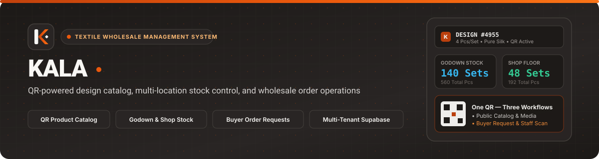

<p align="center">
  
</p>

<h1 align="center">Kala ERP — Multi-Company Textile ERP</h1>

<p align="center">
  <strong>Modern, accounting-grade ERP for Indian textile wholesalers, fabric stockists, mills, manufacturers, and agents.</strong><br/>
  One PostgreSQL data foundation · One TypeScript domain layer · Built for Web, Mobile, and Windows Desktop.
</p>

<p align="center">
  
  
  
  
</p>

---

## What is Kala ERP?

**Kala** evolved from a QR-based wholesale catalog and order-management app into a **five-layer, multi-company Textile ERP** engineered with strict database-enforced accounting and inventory integrity.

- **Target Industries:** Textile wholesalers & traders, fabric/taka stockists, dyeing & printing mills, embroidery units, garment manufacturers, and textile agents.
- **Commercial Readiness:** Architected to support both **SaaS subscriptions** and **dedicated Enterprise deployments** from one codebase.
- **Access Channels:** **Kala Web** (Cloud — *Implemented*), **Kala Mobile** (Capacitor Android/iOS — *Implemented shell & QR scanner; offline queue planned*), and **Kala Desktop** (Windows Tauri v2 with silent thermal printing — *Designed, Stage 6*).

> **Engineering Honesty Rule:** Kala documentation strictly distinguishes **Implemented**, **In Progress**, **Designed**, and **Planned** capabilities. See [`docs/IMPLEMENTATION_STATUS.md`](docs/IMPLEMENTATION_STATUS.md) for the exact reality matrix on `main`.

---

## Five-Layer Architecture & Current Status

| Layer | Capabilities | Migrations | Status |
| :--- | :--- | :---: | :---: |
| **1. Kala Core** | Fail-closed multi-company tenancy (`x-business-id`), branches, non-overlapping financial years & lock triggers, ordered document counters, granular RBAC (`roles`/`role_permissions`), payload-hashed idempotency, immutable `audit_events`, self-service onboarding & owner team invites | `001`–`014` | **Implemented** |
| **2. Kala Inventory** | Unified append-only `stock_ledger`, SET projection with Moving Weighted Average Cost (MWAC), product variants, dye/mill lots, serialized takas with parent-child split lineage (`taka_splits`), chronological posting guards, reserved-stock protection, 3-way `verify_inventory_integrity()` | `015`–`019` | **Implemented** *(DB & Service Layer; Taka UI planned)* |
| **3. Kala Operations** | Permanent QR product pages, rate-limited buyer order requests, wholesale orders, party/agent directories, PDFs *(Implemented)* · GST Sales/Purchase invoices, Credit/Debit Notes, Job Work Challans, Mill Processing, BOM/Manufacturing *(Designed/Planned)* | `002`–`006`, `018` (`025`–`035` planned) | **Partial** *(Wholesale Orders Implemented; Purchases & Manufacturing Planned)* |
| **4. Kala Finance** | Chart of Accounts, Cost Centres, strictly immutable double-entry vouchers & separate reversal vouchers, dual-locked `bill_allocations`, date-effective Indian GST engine & immutable tax snapshots, Trial Balance / P&L / Balance Sheet, FY Close | `020`–`024`, `025`–`030`, `036`–`038` *(planned)* | **Designed** *(Next: Stage 3)* |
| **5. Kala Intelligence & Platform** | Textile & Business BI (fast/slow designs, lot margins, overdue ageing, mill shortage %), tenant-safe AI assistant via whitelisted read-only RPCs, E-Invoice/E-Way Bill, and Super-Admin Platform/Developer Console | `039`–`044` *(planned)* | **Planned** *(Stages 7–8)* |

---

## Implemented Highlights on `main`

- **Commercial Flat ERP UI**: Rebuilt Admin shell (`Dashboard`, `Products`, `Stock`, `Orders`, `Requests`, `Parties`, `Agents`, `Scan`, `Settings`) and mobile `/staff` bottom-bar scanner using `IBM Plex Sans` (with Gujarati/Devanagari fallbacks), `tabular-nums`, `en-IN` currency (`₹12,45,000`), and `DD MMM YYYY` dates.
- **Permanent Public QR Commerce**: Every product generates a permanent QR URL (`/:slug/p/:designNo`) served through fail-closed `SECURITY DEFINER` public RPCs with hourly per-business and per-phone rate caps.
- **Fail-Closed Multi-Company Tenancy**: Users belonging to multiple companies switch seamlessly via scoped `x-business-id` headers (`/rest/v1/` and `/functions/v1/`). Missing or unauthorized headers fail closed to `NULL` at the PostgreSQL RLS and RPC layers.
- **Unified Inventory & Valuation Engine**: Direct client writes to `inventory_stock`, `inventory_lots`, `inventory_takas`, `taka_splits`, `stock_ledger`, and `audit_events` are revoked. Every intake, atomic 2-row transfer, taka split, and order dispatch executes inside transactional `SECURITY DEFINER` RPCs and reconciles 3 ways via `verify_inventory_integrity()`.

---

## Authoritative Documentation (`docs/`)

| Document | Purpose |
| :--- | :--- |
| [`docs/PRODUCT_VISION.md`](docs/PRODUCT_VISION.md) | Complete Kala ERP vision, target textile segments, and Web/Desktop/Mobile strategy |
| [`docs/MASTER_ROADMAP.md`](docs/MASTER_ROADMAP.md) | Stage 0–8 engineering roadmap and mandatory automated exit gates |
| [`docs/IMPLEMENTATION_STATUS.md`](docs/IMPLEMENTATION_STATUS.md) | Ground-truth matrix of what is **Implemented** today vs. **Designed** / **Planned** |
| [`docs/SYSTEM_ARCHITECTURE.md`](docs/SYSTEM_ARCHITECTURE.md) | Five-layer system topology, frontend design, QR gateway, and Tauri v2 / offline protocol |
| [`docs/DATABASE_ARCHITECTURE.md`](docs/DATABASE_ARCHITECTURE.md) | Migrations `001`–`019`, composite multi-tenant FKs, `stock_ledger`, MWAC & Taka lineage |
| [`docs/ERP_MODULE_SPECIFICATION.md`](docs/ERP_MODULE_SPECIFICATION.md) | Detailed functional specification across all five ERP layers |
| [`docs/ACCOUNTING_SPECIFICATION.md`](docs/ACCOUNTING_SPECIFICATION.md) | Stage 3–4 double-entry accounting, immutable reversals, dual-locked allocations, and Indian GST engine |
| [`docs/SECURITY_ARCHITECTURE.md`](docs/SECURITY_ARCHITECTURE.md) | Multi-company RLS, `SECURITY DEFINER` contract, RBAC, revoked internal helpers, and Storage isolation |
| [`docs/API_AND_RPC_REFERENCE.md`](docs/API_AND_RPC_REFERENCE.md) | Complete reference of implemented PostgreSQL RPCs, Edge Functions, and TypeScript services |
| [`docs/PLATFORM_ADMIN_ARCHITECTURE.md`](docs/PLATFORM_ADMIN_ARCHITECTURE.md) | Future Super-Admin & Developer Console architecture (Stage 8) |
| [`docs/CONTRIBUTING.md`](docs/CONTRIBUTING.md) | Local setup, engineering guardrails, UI tokens, and mandatory PostgreSQL/build verification |
| [`SUPABASE_SETUP.md`](SUPABASE_SETUP.md) | Step-by-step Supabase project, migrations (`001`–`019`), storage, and Edge Function setup |

Historical architecture blueprints and Phase 1 specs are preserved in [`docs/archive/`](docs/archive/).

---

## Quick Start

```bash
# 1. Clone and install dependencies
git clone https://github.com/404Vardan/kala-textiles.git
cd kala-textiles
npm install

# 2. Configure local environment (never commit .env.local or service_role keys)
cp .env.example .env.local

# 3. Apply migrations 001–019 to your Supabase / PostgreSQL project (see SUPABASE_SETUP.md)

# 4. Run development server
npm run dev
```

### Verification Commands

```bash
# TypeScript type check & production bundle
npx tsc --noEmit
npm run build
```

Database migrations (`001`–`019`) and automated SQL test suites (`supabase/tests/isolation.sql`, `supabase/tests/stage1_core.sql`, `supabase/tests/stage2_inventory.sql`) are verified sequentially against PostgreSQL (`btree_gist` enabled) before merging any stage to `main`.

---

## License

MIT — see [`LICENSE`](LICENSE).
