<div align="center">

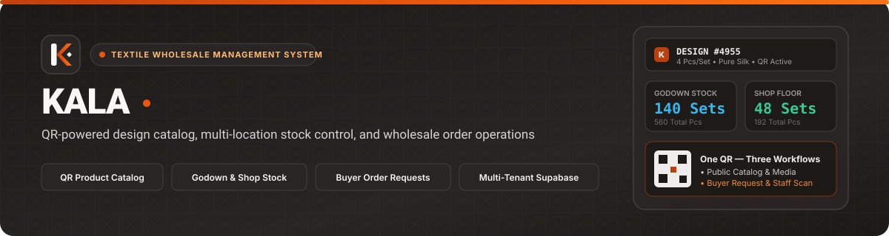

# Kala — Textile Wholesale Management System

**QR-enabled textile wholesale management system for product catalogs, multi-location inventory, buyer order requests, staff floor scanning, and transactional wholesale order workflows.**

[](https://react.dev/)
[](https://www.typescriptlang.org/)
[](https://vite.dev/)
[](https://tailwindcss.com/)
[](https://supabase.com/)
[](https://www.postgresql.org/)
[](https://capacitorjs.com/)
[](LICENSE)
[](https://github.com/404Vardan/rangoli-)

[System Specification](docs/SPEC.md) · [Architecture Guide](docs/ARCHITECTURE.md) · [Contributing Guide](docs/CONTRIBUTING.md) · [Supabase Setup](SUPABASE_SETUP.md)

</div>

---

## 1. Project Overview

**Kala** is a multi-tenant wholesale textile operations platform built for textile manufacturers, showroom operators, and wholesale merchants. It connects physical fabric bales and sample hangers on the shop floor to a live digital catalog, dual-location inventory ledger (**Godown Warehouse** and **Shop Floor**), buyer order-request queue, staff mobile scanning terminal, and A4 PDF order & invoice dispatch engine.

A single permanent QR code printed on each textile design label (`/:slug/p/:designNo`) serves two distinct workflows depending on who scans it:

- **Wholesale Buyers (Public Scan):** View product photography/video, fabric specifications, set ratio (`pcs_per_set`), and wholesale rate; build a multi-design order list in sets; and submit an order request directly to the shop or share it via WhatsApp.
- **Authenticated Shop Staff & Owners (Internal Scan):** Immediately see live **Shop Floor** and **Godown Warehouse** stock balances on the same page or inside the dedicated **Shop Floor Scanner**, and add set quantities directly into an active wholesale draft order.

---

## 2. Problem Statement

Traditional wholesale textile showrooms and godowns face recurring operational bottlenecks:

1. **Disconnected Physical Samples & Digital Catalogs:** Buyers inspecting physical fabric samples on the showroom floor must manually write down design numbers (`Design #4955`), set ratios (`4 pcs/set`), and rates on paper slips.
2. **Split Inventory Blind Spots:** Sales staff at the counter rarely have real-time visibility into how many sets are physically on the **Shop Floor** versus stored in the **Godown Warehouse**, leading to over-promising or delayed dispatches.
3. **Unstructured Buyer Inquiries:** Orders sent as free-form WhatsApp messages lack structured design IDs, validated set quantities, or automatic conversion into draft wholesale orders.
4. **Non-Atomic Stock Deductions:** Client-side stock updates without database row locking risk race conditions when multiple staff members transfer stock or confirm wholesale orders simultaneously.

---

## 3. Our Solution

**Kala** solves these problems through a unified **One-QR Commercial Workflow** backed by PostgreSQL transactional RPCs and Row Level Security (RLS):

- **Permanent Design QR Labels:** Every design registered in [`ProductTab.tsx`](src/components/admin/ProductTab.tsx) generates a printable `75mm × 50mm` thermal label via [`qrcode.ts`](src/utils/qrcode.ts) pointing to `/:slug/p/:designNo`. Updating rates or media never invalidates printed bale labels.
- **Structured Buyer Order Requests:** Buyers scanning multiple sample tags add sets (`1–500`) to a tenant-scoped order list ([`orderRequestCart.ts`](src/services/orderRequestCart.ts)) and submit via the `submit_order_request` RPC or formatted WhatsApp message on [`OrderRequestPage.tsx`](src/pages/OrderRequestPage.tsx).
- **One-Click Draft Order Conversion:** Business owners review incoming buyer requests in [`OrderRequestsSection.tsx`](src/components/admin/OrderRequestsSection.tsx) and convert approved requests into draft wholesale orders (`RNG-YYYY-NNNN`) via `convert_order_request` without prematurely deducting stock.
- **Transactional Inventory & Order Confirmation:** Stock inward intake (`intake_stock_tx`), Godown-to-Shop transfers (`transfer_stock_tx`), and order confirmation with stock deduction (`confirm_order_and_deduct_stock_tx`) execute inside `SECURITY DEFINER` PostgreSQL transactions with `FOR UPDATE` row-level locks.

---

## 4. Key Features

| Domain | Capabilities Implemented | Primary Modules |
| :--- | :--- | :--- |
| **Product Catalog & Media** | Design registration (`design_no`, `brand`, `collection_name`, `fabric`, `rate`, `pcs_per_set`), multi-image/video gallery upload, primary photo selection, active/archive toggle, and `75mm × 50mm` QR label printing. | [`ProductTab.tsx`](src/components/admin/ProductTab.tsx), [`MediaManager.tsx`](src/components/admin/MediaManager.tsx), [`products.ts`](src/services/products.ts) |
| **Public QR Product Page** | Public catalog view at `/:slug/p/:designNo` via `get_public_product` RPC, media carousel, set specification card, set quantity stepper (`1–500`), persistent bottom order bar, and customer inquiry submission. | [`ProductPage.tsx`](src/pages/ProductPage.tsx), [`InquiryForm.tsx`](src/components/common/InquiryForm.tsx) |
| **Buyer Order Requests** | Tenant-isolated `localStorage` cart (`kala:order-request-cart:${slug}` with automatic migration from legacy keys), set quantity validation, dual submission (**Send to Shop** via `submit_order_request` RPC + **Send on WhatsApp** via `wa.me`), and reference ID confirmation. | [`OrderRequestPage.tsx`](src/pages/OrderRequestPage.tsx), [`orderRequests.ts`](src/services/orderRequests.ts), [`orderRequestCart.ts`](src/services/orderRequestCart.ts) |
| **Multi-Location Inventory** | Separate **Godown Warehouse** and **Shop Floor** stock tracking in sets and total pieces, warehouse inward intake, atomic inter-location transfers, and an immutable stock movement audit log (`INTAKE`, `TRANSFER`, `DISPATCH`). | [`StockTab.tsx`](src/components/admin/StockTab.tsx), [`inventory.ts`](src/services/inventory.ts) |
| **Staff Mobile Terminal** | Mobile-first workspace (`/staff`) with GPU-accelerated `BarcodeDetector` + `html5-qrcode` fallback, tenant QR validation, live Shop/Godown stock cards, and shared staff draft order state (`StaffOrderDraftContext`). | [`StaffPage.tsx`](src/pages/StaffPage.tsx), [`ShopScanTab.tsx`](src/components/admin/ShopScanTab.tsx), [`useQRScanner.ts`](src/hooks/useQRScanner.ts) |
| **Wholesale Orders & PDF** | Buyer QR request conversion queue, party/agent autocomplete, camera QR item entry, `Draft` → `Confirmed` / `Cancelled` lifecycle, transactional stock deduction, order duplication, and multi-page Kala-branded A4 vector PDF generation. | [`OrderTab.tsx`](src/components/admin/OrderTab.tsx), [`OrderRequestsSection.tsx`](src/components/admin/OrderRequestsSection.tsx), [`orderPdfGenerator.ts`](src/utils/orderPdfGenerator.ts) |
| **Parties, Agents & Invoices** | Master directories for wholesale buyers (`parties` with station & GSTIN) and commission agents (`agents`), customer inquiries management, and Kala-branded A4 wholesale invoice generation (`invoicePdfGenerator.ts`). | [`PartyTab.tsx`](src/components/admin/PartyTab.tsx), [`AgentTab.tsx`](src/components/admin/AgentTab.tsx), [`InvoiceTab.tsx`](src/components/admin/InvoiceTab.tsx), [`invoicePdfGenerator.ts`](src/utils/invoicePdfGenerator.ts) |
| **Multi-Tenant Auth & RLS** | Supabase Auth session management, explicit single-membership resolution (`owner` / `staff` roles), composite tenant foreign keys, and strict Row Level Security across all business tables. | [`AuthContext.tsx`](src/contexts/AuthContext.tsx), [`005_auth_security_tenancy.sql`](supabase/migrations/005_auth_security_tenancy.sql), [`006_order_requests.sql`](supabase/migrations/006_order_requests.sql) |

---

## 5. Application Screenshots

| **1. Public Landing Page (`/`)** | **2. Public QR Product Page (`/:slug/p/:designNo`)** |
| :---: | :---: |
| 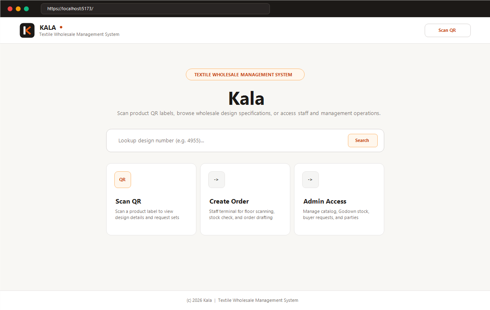 | 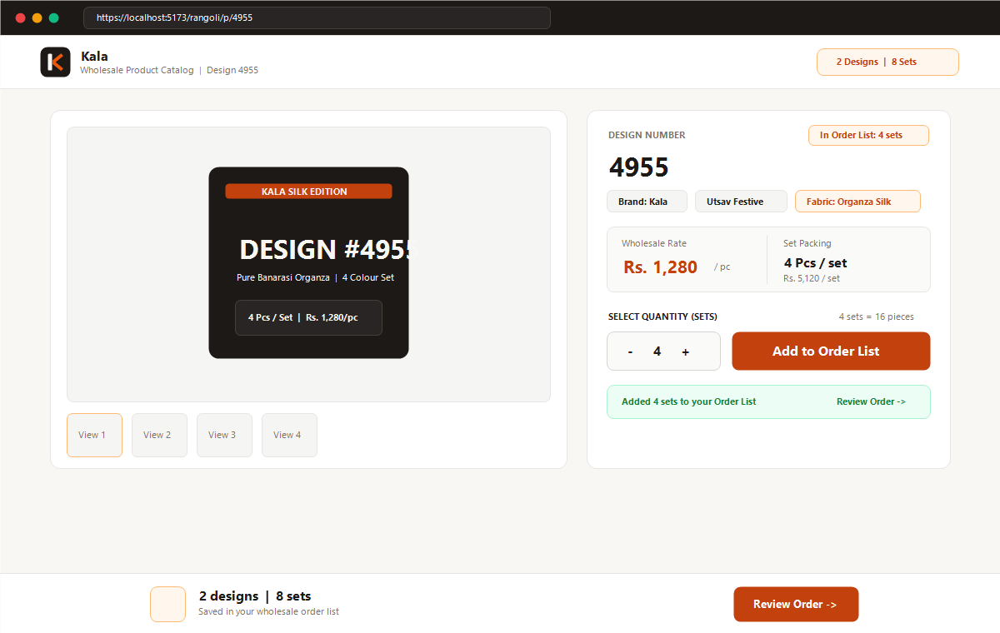 |
| *Commercial entry portal with design lookup, QR scanner, and role workspaces.* | *Wholesale design specification, set ratio (`4 pcs/set`), quantity stepper, and floating order bar.* |
| **3. Buyer Order Checkout (`/:slug/order-request`)** | **4. Owner Executive Dashboard (`/admin`)** |
| 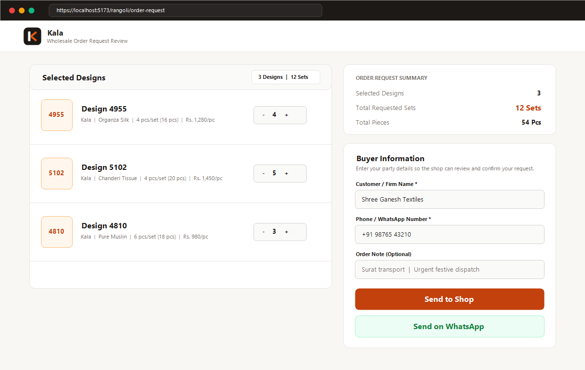 | 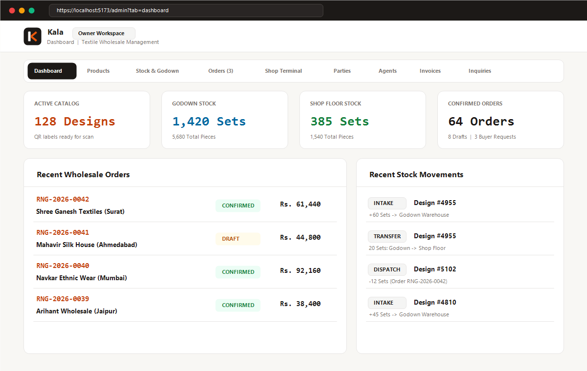 |
| *Multi-design order request review with **Send to Shop** (`submit_order_request` RPC) and **Send on WhatsApp**.* | *Real-time KPIs across Active Catalog, Godown Stock, Shop Floor Stock, Confirmed Orders, and Stock Movements.* |
| **5. Multi-Location Inventory (`/admin?tab=stock`)** | **6. Wholesale Order Form & PDF (`/:slug/order/:orderNo`)** |
| 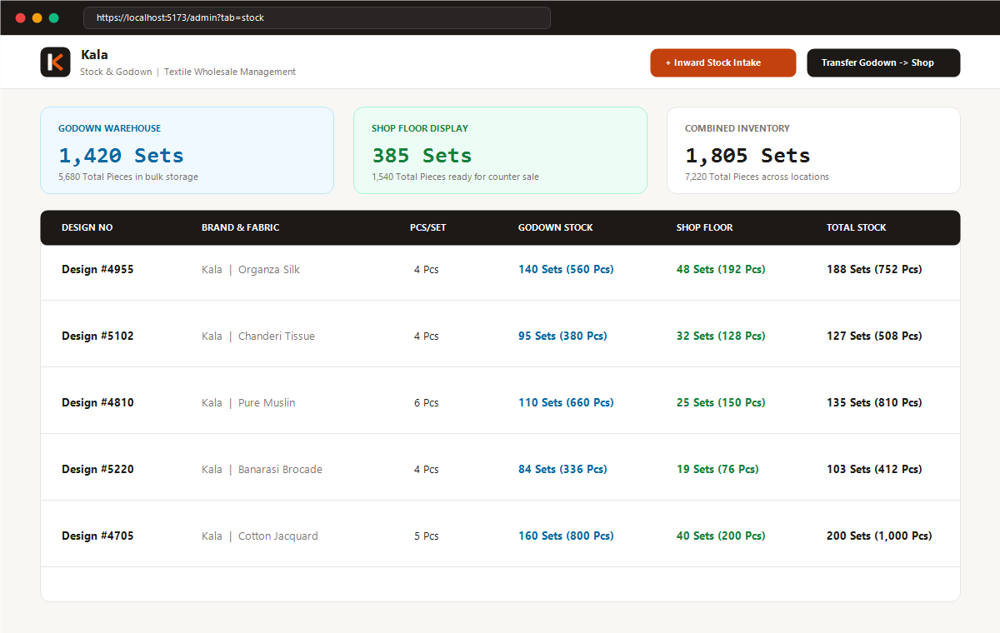 | 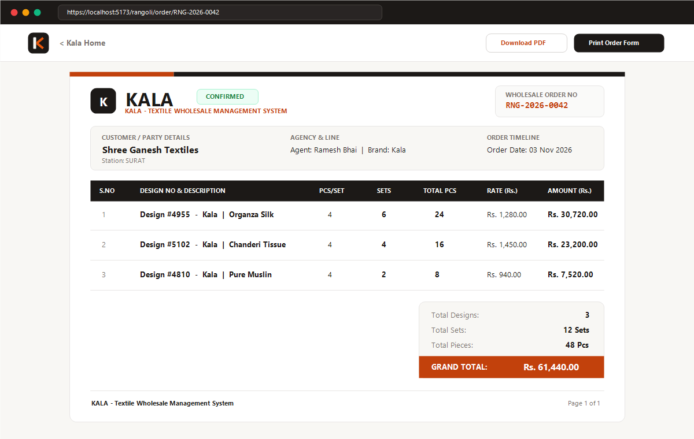 |
| *Dual-location ledger (**Godown Warehouse** vs **Shop Floor**) with transactional inward intake and transfers.* | *Print-ready A4 wholesale order sheet (`RNG-2026-0042`) with vector KALA header and set/piece totals.* |
| **7. Wholesale Invoice PDF (`/:slug/invoice/:invoiceNo`)** | **8. Staff Floor Scanner (`/staff`)** |
| 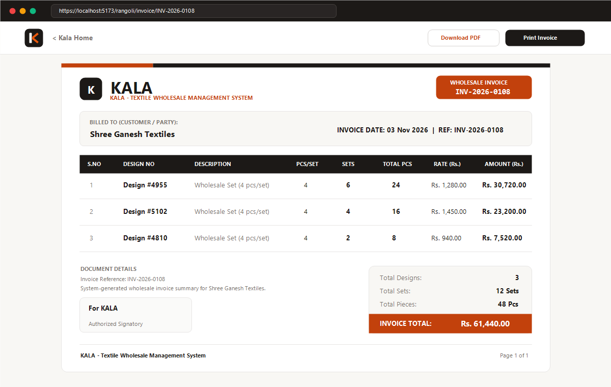 | 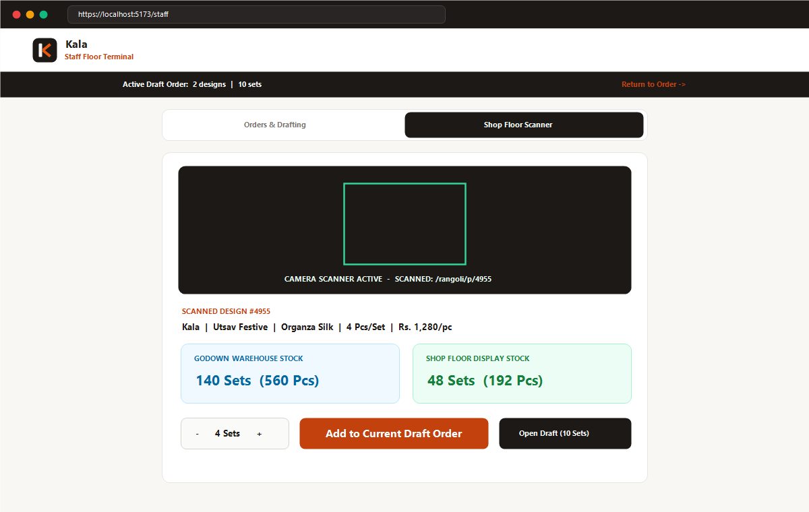 |
| *Kala-branded A4 wholesale invoice (`INV-2026-0108`) with itemized set breakdown and signatory block.* | *Mobile terminal with camera QR recognition, live Godown/Shop stock check, and shared draft order bar.* |

---

## 6. System Architecture

### 6.1 High-Level Component Architecture

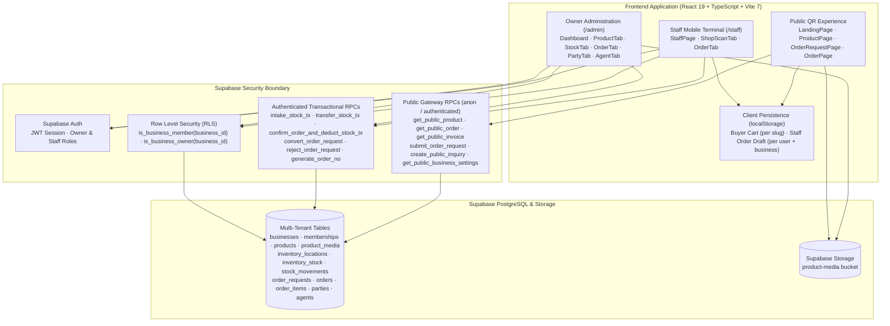

### 6.2 Buyer QR Ordering & Owner Conversion Workflow

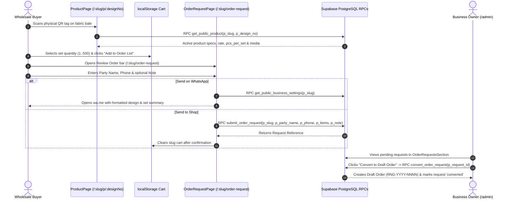

### 6.3 Multi-Location Inventory & Order Stock Deduction Workflow

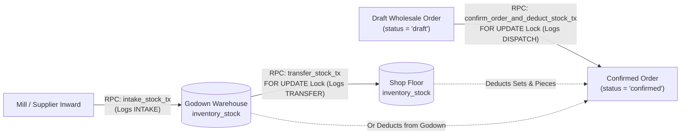

### 6.4 Staff Floor Scanning & Shared Draft Workflow

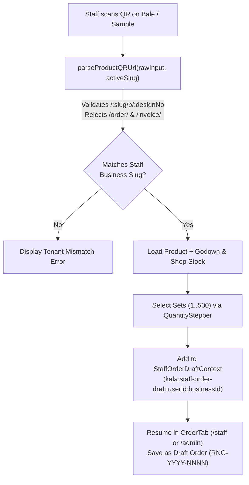

---

## 7. Technology Stack

| Layer | Technology | Version | Purpose |
| :--- | :--- | :--- | :--- |
| **UI Framework** | React + React DOM | `^19.2.4` | Component architecture and concurrent rendering |
| **Language** | TypeScript | `~5.9.3` | Strict static typing across services, contexts, and database models |
| **Build Tool** | Vite | `^7.3.1` | Fast ES module dev server and optimized production bundling |
| **Styling** | Tailwind CSS + `@tailwindcss/vite` | `^4.2.1` | Utility-first styling with custom commercial stone & burnt-orange design tokens |
| **UI Primitives** | Radix UI (`Dialog`, `AlertDialog`, `Select`, `Tabs`, `Label`) | Latest | Accessible modal dialogs, tabs, and confirmation prompts |
| **Routing** | React Router DOM | `^7.13.1` | Tenant-prefixed (`/:slug/...`) and legacy route resolution |
| **Backend & Auth** | Supabase (`@supabase/supabase-js`) | `^2.98.0` | PostgreSQL database, Auth sessions, Storage, RLS, and RPC execution |
| **QR Generation & Scanning** | `qrcode`, `qrcode.react`, `html5-qrcode` | `^1.5.4` / `^2.3.8` | High-density QR label generation and camera scanning with native `BarcodeDetector` |
| **PDF Engine** | `jspdf` + `html2canvas` | `^4.2.0` | Vector A4 wholesale order sheet and invoice PDF generation |
| **Mobile Packaging** | Capacitor (`@capacitor/core`, `@capacitor/android`, `@capacitor/camera`) | `^8.2.0` | Native Android wrapper support |

---

## 8. Database and Security Architecture

The PostgreSQL schema evolves through sequential migrations in [`supabase/migrations/`](supabase/migrations/):

1. [`001_init.sql`](supabase/migrations/001_init.sql) — Initial `products`, `product_media`, `invoices`, `invoice_items`, `inquiries`, and `admin_settings` tables.
2. [`002_orders_inventory.sql`](supabase/migrations/002_orders_inventory.sql) & [`002_add_staff_password.sql`](supabase/migrations/002_add_staff_password.sql) — Initial orders and inventory structures.
3. [`003_add_invoice_pcs_per_set.sql`](supabase/migrations/003_add_invoice_pcs_per_set.sql) — Set ratio tracking on invoice line items.
4. [`004_rangoli_core_system.sql`](supabase/migrations/004_rangoli_core_system.sql) — Core locations (`Godown`, `Shop`), `inventory_stock`, `stock_movements`, `parties`, `agents`, and order item triggers.
5. [`005_auth_security_tenancy.sql`](supabase/migrations/005_auth_security_tenancy.sql) — Full multi-tenant architecture (`businesses`, `memberships`), removal of legacy permissive policies, composite tenant-aware foreign keys, strict RLS policies, and transactional inventory/order RPCs.
6. [`006_order_requests.sql`](supabase/migrations/006_order_requests.sql) — `order_requests` and `order_request_items` tables, column-level privilege hardening, `submit_order_request`, `convert_order_request`, `reject_order_request`, `get_public_business_settings`, and `update_business_whatsapp_number`.

### Core Security Invariants

- **Zero Anonymous Direct Table Access:** Anonymous (`anon`) users have no direct `SELECT`/`INSERT`/`UPDATE`/`DELETE` access on business tables. Public QR pages operate strictly through validated `SECURITY DEFINER` gateway RPCs and fail closed on error.
- **Explicit Single-Membership Resolution:** Both the PostgreSQL helper `current_user_business_id()` and frontend [`AuthContext.tsx`](src/contexts/AuthContext.tsx) require an authenticated user to have exactly one active business membership, preventing cross-tenant ambiguity.
- **Server-Derived Set Quantities & Rates:** Stock intake, transfers, and order item triggers (`guard_and_sync_order_items`) derive `pcs_per_set` and validate product ownership on the server rather than trusting client-supplied calculations.

For a deep dive into the schema, triggers, and RPCs, see **[docs/ARCHITECTURE.md](docs/ARCHITECTURE.md)**.

---

## 9. Project Structure

```text
kala-textiles/
├── .github/
│   ├── ISSUE_TEMPLATE/
│   │   ├── bug_report.yml               # Structured GitHub bug report form
│   │   └── feature_request.yml          # Structured GitHub feature request form
│   ├── workflows/
│   │   └── ci.yml                       # GitHub Actions CI (tsc --noEmit & vite build)
│   └── pull_request_template.md         # Standard PR checklist and verification template
├── android/                             # Capacitor Android native project
├── docs/
│   ├── assets/
│   │   ├── screenshots/                 # Application screen previews (8 screens)
│   │   ├── readme-banner.svg            # Custom repository header banner
│   │   └── social-preview.png           # 1280x640 GitHub social preview card
│   ├── ARCHITECTURE.md                  # Deep-dive system & database architecture guide
│   ├── CONTRIBUTING.md                  # Contributor workflow & engineering standards
│   └── SPEC.md                          # Authoritative functional & RPC specification
├── public/
│   └── branding/                        # Official Kala SVG brand system (logo, light, icon, favicon, wordmark)
├── supabase/
│   └── migrations/
│       ├── 001_init.sql
│       ├── 002_add_staff_password.sql
│       ├── 002_orders_inventory.sql
│       ├── 003_add_invoice_pcs_per_set.sql
│       ├── 004_rangoli_core_system.sql
│       ├── 005_auth_security_tenancy.sql
│       └── 006_order_requests.sql
├── src/
│   ├── components/
│   │   ├── admin/                       # Admin & Staff operational modules
│   │   │   ├── AgentTab.tsx
│   │   │   ├── DashboardTab.tsx
│   │   │   ├── InquiryTab.tsx
│   │   │   ├── InvoiceTab.tsx
│   │   │   ├── MediaManager.tsx
│   │   │   ├── OrderRequestsSection.tsx
│   │   │   ├── OrderTab.tsx
│   │   │   ├── PartyTab.tsx
│   │   │   ├── ProductTab.tsx
│   │   │   ├── SettingsDialog.tsx
│   │   │   ├── ShopScanTab.tsx
│   │   │   └── StockTab.tsx
│   │   ├── common/                      # KalaLogo, ProtectedRoute, ErrorBoundary, InquiryForm
│   │   ├── galleries/                   # MediaCarousel
│   │   ├── invoices/                    # InvoiceForm, InvoicePreview, InvoiceTable
│   │   ├── products/                    # ProductForm, ProductTable, QRModal
│   │   └── ui/                          # Design system primitives (button, input, dialog, primitives)
│   ├── contexts/
│   │   ├── AuthContext.tsx              # Supabase Auth & single-tenant membership context
│   │   └── StaffOrderDraftContext.tsx   # Shared localStorage draft order state for staff
│   ├── hooks/                           # useAuth, useStaffAuth, useQRScanner, useProducts, useInvoices
│   ├── pages/                           # Route-level pages (Landing, Login, Admin, Staff, Product, OrderRequest, Order, Invoice)
│   ├── services/                        # Supabase RPC & table service layer
│   ├── types/                           # TypeScript domain interfaces
│   ├── utils/                           # QR parser/generator, PDF generators, formatters, validators
│   ├── App.tsx                          # Application router & provider tree
│   ├── main.tsx                         # React DOM root entry
│   └── style.css                        # Tailwind CSS v4 & commercial design system variables
├── .env.example                         # Template for required Vite environment variables
├── LICENSE                              # All Rights Reserved proprietary showcase notice
├── capacitor.config.ts                  # Capacitor mobile configuration
├── package.json                         # Dependencies and build scripts
├── tsconfig.json                        # Strict TypeScript compiler configuration
└── vite.config.ts                       # Vite bundler configuration
```

---

## 10. Getting Started

### Prerequisites

- **Node.js:** `v18.0.0` or higher (`v20+` LTS recommended)
- **npm:** `v9.0.0` or higher
- **Supabase Project:** A hosted [Supabase](https://supabase.com/) project or local Supabase CLI instance

### Installation

1. **Clone the repository:**

   ```bash
   git clone https://github.com/404Vardan/rangoli-.git
   cd rangoli-
   ```

2. **Install dependencies:**

   ```bash
   npm install
   ```

3. **Create your local environment file:**

   ```bash
   cp .env.example .env.local
   ```

4. **Start the development server:**

   ```bash
   npm run dev
   ```

   The application will be available at `http://localhost:5173`.

---

## 11. Environment Configuration

The frontend references three Vite environment variables defined in [`.env.example`](.env.example):

```dotenv
VITE_SUPABASE_URL=https://your-project.supabase.co
VITE_SUPABASE_ANON_KEY=your-anon-key
VITE_PUBLISHED_DOMAIN=https://your-domain.vercel.app
```

| Variable | Required | Referenced In | Description |
| :--- | :---: | :--- | :--- |
| `VITE_SUPABASE_URL` | **Yes** | [`src/services/supabase.ts`](src/services/supabase.ts) | Your Supabase project URL (`Settings → API → Project URL`). |
| `VITE_SUPABASE_ANON_KEY` | **Yes** | [`src/services/supabase.ts`](src/services/supabase.ts) | Your Supabase public anonymous key (`Settings → API → anon public`). |
| `VITE_PUBLISHED_DOMAIN` | Optional | [`src/utils/qrcode.ts`](src/utils/qrcode.ts) | Canonical public domain embedded into printed product QR codes (falls back to `window.location.origin`). |

> **Security Warning:** Never place your Supabase `service_role` secret key, database password, or private credentials in `.env.local` or any `VITE_*` variable. All `VITE_*` variables are bundled into the client browser build. Confirm that `.env` and `.env.*` (except `.env.example`) remain ignored via [`.gitignore`](.gitignore).

---

## 12. Supabase Setup

1. **Run Database Migrations in Order:**
   Open the **Supabase SQL Editor** and execute the migration scripts under [`supabase/migrations/`](supabase/migrations/) in numerical order:
   - `001_init.sql`
   - `002_orders_inventory.sql`
   - `002_add_staff_password.sql`
   - `003_add_invoice_pcs_per_set.sql`
   - `004_rangoli_core_system.sql`
   - `005_auth_security_tenancy.sql`
   - `006_order_requests.sql`

2. **Configure Storage Bucket:**
   Ensure the public storage bucket `product-media` exists in **Supabase Storage** (created/configured by migration `005_auth_security_tenancy.sql` for authenticated member uploads and public read access).

3. **Provision Owner & Staff Accounts:**
   - Create users in **Supabase Authentication → Users**.
   - Link each user's `auth.users.id` to your business in `public.memberships` with role `'owner'` or `'staff'`:

   ```sql
   INSERT INTO public.memberships (user_id, business_id, role, is_active)
   SELECT '<AUTH_USER_UUID>', id, 'owner', true
   FROM public.businesses
   WHERE slug = 'rangoli';
   ```

---

## 13. Available Commands

All scripts verified against [`package.json`](package.json):

| Command | Action |
| :--- | :--- |
| `npm run dev` | Starts the Vite local development server with Hot Module Replacement (HMR). |
| `npm run build` | Runs `tsc && vite build` to type-check the entire project and output the production bundle to `dist/`. |
| `npm run preview` | Serves the compiled production build locally from `dist/` for pre-deployment verification. |
| `npx tsc --noEmit` | Runs the TypeScript compiler in verification mode without emitting files. |

---

## 14. Future Improvements / Roadmap

The following enhancements are planned for future iterations (and are **not** yet part of the current release):

- [ ] **Automated End-to-End Test Suite:** Playwright browser tests covering QR scan parsing, buyer order request submission, and owner draft order conversion.
- [ ] **Barcode / Thermal Printer Presets:** Additional label size presets (`50mm × 25mm`, `100mm × 50mm`) alongside the existing `75mm × 50mm` thermal label layout.
- [ ] **Low-Stock Threshold Alerts:** Configurable minimum set thresholds per design for Godown and Shop Floor replenishment notifications.
- [ ] **Batch CSV Catalog Import:** Bulk design registration and initial stock intake from spreadsheet exports.

---

## 15. License

**Copyright © 2026 Vardan (@404Vardan). All Rights Reserved.**

This repository and its source code, database migrations, branding assets, and documentation are proprietary and published for portfolio showcase and architectural review purposes only. See [`LICENSE`](LICENSE) for full terms.

---

## 16. Author & Project Credits

- **Repository:** [github.com/404Vardan/rangoli-](https://github.com/404Vardan/rangoli-)
- **Maintainer:** [@404Vardan](https://github.com/404Vardan)
- **Domain:** Commercial Textile Wholesale & Multi-Location Inventory Operations

