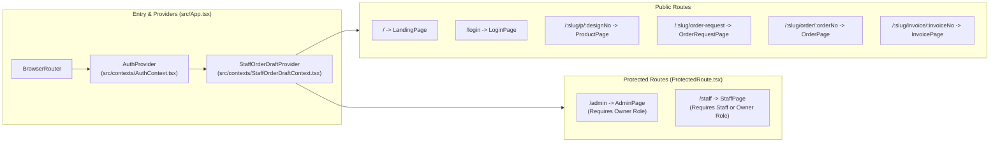
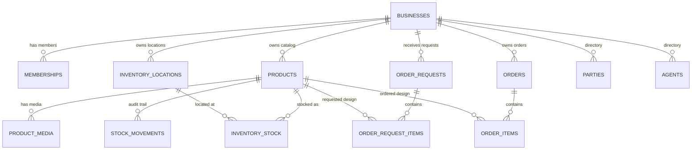

# Kala — System & Database Architecture

This document provides a technical overview of the **Kala — Textile Wholesale Management System** architecture, covering frontend module organization, multi-tenant data isolation, Row Level Security (RLS), transactional PostgreSQL RPCs, QR routing, and client-side state persistence.

---

## 1. Architectural Principles

1. **Fail-Closed Security Boundary:** Public QR pages (`/:slug/p/:designNo`, `/:slug/order/:orderNo`, `/:slug/invoice/:invoiceNo`, and `/:slug/order-request`) never query business tables directly. They invoke narrowly scoped `SECURITY DEFINER` PostgreSQL RPCs and fail closed if an RPC returns an error.
2. **Server-Enforced Tenancy & Integrity:** Every operational table carries a `business_id` column constrained by composite tenant-aware foreign keys. PostgreSQL RLS policies enforce `is_business_member(business_id)` for read/write operations and `is_business_owner(business_id)` for destructive or administrative actions.
3. **Atomic Inventory & Order Mutations:** Stock intake, inter-location transfers, buyer request conversion, and order confirmation execute inside single database transactions using `FOR UPDATE` row locks.
4. **One QR, Dual Context:** A single permanent URL (`/:slug/p/:designNo`) serves public wholesale buyers (anonymous catalog + order request cart) and authenticated shop staff (live Godown/Shop Floor stock balances + shared staff draft order).

---

## 2. Frontend Architecture

### 2.1 Contexts & State Management

| Context / Store | File | Storage Key | Responsibility |
| :--- | :--- | :--- | :--- |
| **`AuthContext`** | [`src/contexts/AuthContext.tsx`](../src/contexts/AuthContext.tsx) | Supabase Auth Session | Manages user authentication, loads `memberships` joined with `businesses`, enforces single active membership, and exposes `isOwner`, `isStaff`, `business`, and `membershipError`. |
| **`StaffOrderDraftContext`** | [`src/contexts/StaffOrderDraftContext.tsx`](../src/contexts/StaffOrderDraftContext.tsx) | `kala:staff-order-draft:${user.id}:${business.id}` | Persists an unsaved wholesale order draft across `ProductPage`, `ShopScanTab`, and `OrderTab` so staff can scan multiple bales and save a single draft order (auto-migrates legacy `rangoli:*` keys). |
| **Buyer Order Request Cart** | [`src/services/orderRequestCart.ts`](../src/services/orderRequestCart.ts) | `kala:order-request-cart:${slug}` | Stores a buyer's selected designs and set quantities (`1..500`) per business slug in `localStorage` and synchronizes across components via a custom DOM event (auto-migrates legacy `rangoli:*` keys). |

### 2.2 Service Layer (`src/services/`)

All Supabase interactions are encapsulated in dedicated service modules:

- [`supabase.ts`](../src/services/supabase.ts) — Initializes the singleton Supabase client using `VITE_SUPABASE_URL` and `VITE_SUPABASE_ANON_KEY`.
- [`products.ts`](../src/services/products.ts) — Authenticated CRUD for `products` and `product_media`, plus `fetchPublicProduct` (`get_public_product` RPC).
- [`inventory.ts`](../src/services/inventory.ts) — Location queries (`fetchLocations`), stock queries (`fetchAllStock`, `fetchStockByProduct`), and transactional RPC wrappers (`intakeStock`, `transferStock`, `confirmOrderAndDeductStock`, `fetchDashboardMetrics`).
- [`orders.ts`](../src/services/orders.ts) — Wholesale order CRUD, atomic sequence generation (`generateOrderNo` via `generate_order_no` RPC), order duplication, and `fetchPublicOrder` (`get_public_order` RPC).
- [`orderRequests.ts`](../src/services/orderRequests.ts) — Public buyer request submission (`submitOrderRequest` via `submit_order_request` RPC) and authenticated owner actions (`fetchOrderRequests`, `convertOrderRequest`, `rejectOrderRequest`).
- [`parties.ts`](../src/services/parties.ts) & [`agents.ts`](../src/services/agents.ts) — Master directory lookups and auto-registration during order creation.
- [`adminSettings.ts`](../src/services/adminSettings.ts) — Public business settings lookup (`get_public_business_settings`), owner WhatsApp contact update (`update_business_whatsapp_number`), and Supabase Auth password updates.
- [`storage.ts`](../src/services/storage.ts) — Media upload and cleanup against the `product-media` bucket.

---

## 3. Database Schema & Multi-Tenant Integrity

### 3.1 Composite Tenant Foreign Keys (Migrations 005 & 006)

To guarantee that child rows can never reference a parent record belonging to another tenant, tables carry composite unique indexes `(id, business_id)` and composite foreign keys:

- `product_media(product_id, business_id)` → `products(id, business_id)`
- `inventory_stock(product_id, business_id)` → `products(id, business_id)`
- `inventory_stock(location_id, business_id)` → `inventory_locations(id, business_id)`
- `stock_movements(product_id, business_id)` → `products(id, business_id)`
- `order_items(order_id, business_id)` → `orders(id, business_id)`
- `order_request_items(request_id, business_id)` → `order_requests(id, business_id)`
- `order_request_items(product_id, business_id)` → `products(id, business_id)`

---

## 4. Transactional RPC Reference

| RPC Name | Allowed Roles | Description |
| :--- | :--- | :--- |
| `get_public_product(p_slug, p_design_no)` | `anon`, `authenticated` | Returns active product specifications and ordered media for a business slug and design number. |
| `get_public_order(p_slug, p_order_no)` | `anon`, `authenticated` | Returns order header and line items for public QR order sheets. |
| `get_public_invoice(p_slug, p_invoice_no)` | `anon`, `authenticated` | Returns invoice header and items for legacy invoice verification. |
| `create_public_inquiry(...)` | `anon`, `authenticated` | Validates and records a customer inquiry for a specific business and design. |
| `get_public_business_settings(p_slug)` | `anon`, `authenticated` | Returns `{ business_name, business_slug, whatsapp_number }` with placeholder numbers filtered out. |
| `submit_order_request(p_slug, p_party_name, p_phone, p_items, p_note)` | `anon`, `authenticated` | Validates buyer details, aggregates duplicate design numbers, verifies active products in the target business, and inserts `order_requests` + `order_request_items`. |
| `convert_order_request(p_request_id)` | `authenticated` | Locks the request `FOR UPDATE`, verifies `status = 'requested'`, resolves/creates the party, generates an order number (`RNG-YYYY-NNNN`), creates a `draft` order and `order_items`, and marks the request `'converted'`. |
| `reject_order_request(p_request_id)` | `authenticated` | Locks the request `FOR UPDATE`, verifies `status = 'requested'`, and transitions status to `'rejected'`. |
| `intake_stock_tx(...)` | `authenticated` | Atomically increments `inventory_stock` at the target location using product `pcs_per_set` and writes an `INTAKE` movement record. |
| `transfer_stock_tx(...)` | `authenticated` | Locks source and destination stock rows in deterministic order, verifies available sets, moves sets/pieces, and writes a `TRANSFER` movement record. |
| `confirm_order_and_deduct_stock_tx(...)` | `authenticated` | Locks the draft order and all required stock rows, validates sufficient stock across aggregated designs, deducts stock, logs `DISPATCH` movements, and marks the order `'confirmed'`. |
| `generate_order_no()` | `authenticated` | Atomically increments `business_order_counters` for the current business and year, returning `RNG-YYYY-NNNN`. |
| `update_business_whatsapp_number(p_whatsapp_number)` | `authenticated` (Owner) | Validates and merges `whatsapp_number` into `businesses.settings` JSONB without overwriting other settings keys. |

---

## 5. QR URL Parsing & Scanner Cooldown

- **Generation ([`src/utils/qrcode.ts`](../src/utils/qrcode.ts)):**
  Generates permanent URLs in the format `https://<domain>/:slug/p/:designNo`.
- **Validation (`parseProductQRUrl`):**
  Accepts `/:slug/p/:designNo`, legacy `/p/:designNo`, or plain design codes while explicitly rejecting `/order/`, `/invoice/`, and `/order-request/` URLs during product scanning.
- **Hardware Acceleration ([`src/hooks/useQRScanner.ts`](../src/hooks/useQRScanner.ts)):**
  Uses the browser's native `BarcodeDetector` API when available and falls back to `html5-qrcode`, enforcing a configurable per-code cooldown (`700ms–800ms`) so holding a camera over a tag does not trigger duplicate scans in the same frame window.

