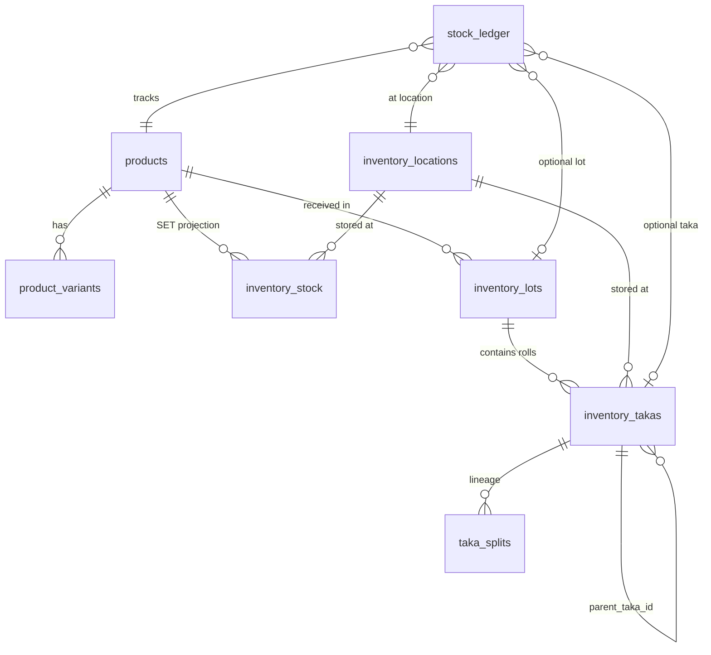

# Kala ERP — Database Architecture

> **Document Role:** Authoritative PostgreSQL schema, migration sequence (`001`–`019` implemented; `020`+ designed/planned), multi-tenant composite FK design, unified `stock_ledger` data model, and valuation/reconciliation invariants.

---

## 1. Migration Sequence (`supabase/migrations/`)

### Implemented Migrations (`001`–`019`, Verified on PostgreSQL)

| Migration | Stage | Summary |
| :--- | :---: | :--- |
| [`001_init.sql`](../supabase/migrations/001_init.sql) | Pre-ERP | Base `products`, `product_media`, `invoices`, `invoice_items`, `inquiries`, `admin_settings`. |
| [`002_add_staff_password.sql`](../supabase/migrations/002_add_staff_password.sql) | Pre-ERP | Legacy staff password column (superseded by Supabase Auth in `005`). |
| [`002_orders_inventory.sql`](../supabase/migrations/002_orders_inventory.sql) | Pre-ERP | Initial `orders`, `order_items`, `inventory_locations`, `inventory_stock`, `stock_movements`. |
| [`003_add_invoice_pcs_per_set.sql`](../supabase/migrations/003_add_invoice_pcs_per_set.sql) | Pre-ERP | Added `pcs_per_set` to `invoice_items`. |
| [`004_rangoli_core_system.sql`](../supabase/migrations/004_rangoli_core_system.sql) | Pre-ERP | `parties`, `agents`, non-negative stock constraints, initial transactional stock RPCs. |
| [`005_auth_security_tenancy.sql`](../supabase/migrations/005_auth_security_tenancy.sql) | Phase 1 | Multi-tenant foundation (`businesses`, `memberships`), composite `(business_id, id)` FKs, strict RLS, transactional order/stock RPCs, fail-closed public QR RPCs. |
| [`006_order_requests.sql`](../supabase/migrations/006_order_requests.sql) | Phase 1 | `order_requests`, `order_request_items`, `submit_order_request`, `convert_order_request`, `reject_order_request`, `get_public_business_settings`. |
| [`007_signup_create_business.sql`](../supabase/migrations/007_signup_create_business.sql) | Phase 1 | Self-service onboarding (`is_reserved_business_slug`, `check_slug_available`, `create_business`). |
| [`008_team_management.sql`](../supabase/migrations/008_team_management.sql) | Phase 1 | Owner-only team RPCs (`list_business_members`, `update_member_role`, `remove_business_member`) + `guard_last_business_owner` trigger. |
| [`009_storage_tenant_policies.sql`](../supabase/migrations/009_storage_tenant_policies.sql) | Phase 1 | `product-media` bucket + tenant-scoped `storage.objects` policies (`{business_id}/{product_id}/{uuid}.{ext}`). |
| [`010_public_rpc_rate_limits.sql`](../supabase/migrations/010_public_rpc_rate_limits.sql) | Phase 1 | `public_request_log`, hourly per-business/per-phone rate limiting (`enforce_public_rate_limit`). |
| [`011_core_multicompany_tenancy.sql`](../supabase/migrations/011_core_multicompany_tenancy.sql) | Stage 1 | Fail-closed request-scoped `current_business_id()` reading `x-business-id` header + strict `business_id = current_business_id()` RLS on all tenant tables. |
| [`012_core_branches_fy_counters.sql`](../supabase/migrations/012_core_branches_fy_counters.sql) | Stage 1 | `branches`, non-overlapping `financial_years` (`btree_gist`), `document_counters`, `next_document_no()`, `assert_financial_year_open()`, `bump_row_version()`. |
| [`013_core_rbac_idempotency_audit.sql`](../supabase/migrations/013_core_rbac_idempotency_audit.sql) | Stage 1 | `roles`, `role_permissions`, `memberships.role_id`, `seed_default_business_roles()`, `has_permission()`, `idempotency_keys`, append-only `audit_events`, upgraded `create_business()`. |
| [`014_stage1_security_hardening.sql`](../supabase/migrations/014_stage1_security_hardening.sql) | Stage 1 | Revoked direct `EXECUTE` on internal helpers (`claim_idempotency_key`, `complete_idempotency_key`, `record_audit_event`), added `guard_locked_financial_year`, `guard_system_roles`, and locked-FY rejection in `next_document_no()`. |
| [`015_inventory_variants_lots_takas.sql`](../supabase/migrations/015_inventory_variants_lots_takas.sql) | Stage 2 | Extended `products` (`tracking_mode`, `uom`, `hsn_code`) and `inventory_stock` (`reserved_sets`, `avg_unit_cost`, `row_version`); created `product_variants`, `inventory_lots`, `inventory_takas`, immutable `taka_splits`. |
| [`016_unified_stock_ledger.sql`](../supabase/migrations/016_unified_stock_ledger.sql) | Stage 2 | Append-only `stock_ledger`, `guard_stock_ledger_immutable` trigger, `OPENING_BALANCE` backfill from `inventory_stock`, internal `assert_chronological_stock_date()`. |
| [`017_inventory_rpcs_and_reconciliation.sql`](../supabase/migrations/017_inventory_rpcs_and_reconciliation.sql) | Stage 2 | `intake_set_stock_v2`, `receive_taka_lot_tx`, `transfer_taka_tx`, `split_taka_tx`, upgraded `intake_stock_tx`/`transfer_stock_tx`, 3-way `verify_inventory_integrity()`. |
| [`018_confirm_order_stock_ledger.sql`](../supabase/migrations/018_confirm_order_stock_ledger.sql) | Stage 2 | Upgraded `confirm_order_and_deduct_stock_tx` to write frozen-cost `DISPATCH` entries to `stock_ledger` and log `audit_events`. |
| [`019_stage2_inventory_hardening.sql`](../supabase/migrations/019_stage2_inventory_hardening.sql) | Stage 2 | Revoked direct writes on `inventory_stock`, enforced `p_business_id = current_business_id()` on all Stage 2 RPCs, added composite FKs on `inventory_lots` to `parties(business_id, id)`, added `assert_chronological_taka_date()`, preserved MWAC in legacy `intake_stock_tx`, enforced `inventory.write` on `product_variants`, enforced unreserved stock (`sets - reserved_sets`) on dispatch. |

### Planned Migrations (`020`+, Not Yet Implemented)
- `020`–`024`: Stage 3 Accounting Core (`accounts`, `cost_centers`, `vouchers`, `voucher_entries`, `bill_allocations`, FY close).
- `025`–`030`: Stage 4 Sales/Purchases & Complete GST Engine (`tax_categories`, `tax_rates`, `sales_invoices`, `purchase_bills`, `invoice_tax_snapshots`).
- `031`–`035`: Stage 5 Job Work, Mill Processing & Manufacturing (challans, BOM, production runs).
- `036`–`044`: Stages 6–8 Financial Reporting views, Intelligence views, Platform Admin & Subscription Gating.

---

## 2. Core Data Model (Implemented)

### 2.1 Tenant & Core Governance (`005`–`014`)
- **`businesses`**: `id BIGINT PK`, `name`, `slug` (unique), `settings JSONB`.
- **`memberships`**: `(user_id, business_id) PK`, `role ('owner'|'staff')`, `role_id BIGINT` referencing `roles(business_id, id)`.
- **`branches`**: `(business_id, id)` composite unique, `code`, `gstin`, `state_code`, `is_default`, `is_active`, `row_version`.
- **`financial_years`**: `(business_id, id)` composite unique, `label`, `start_date`, `end_date`, `is_active`, `is_locked`, with GiST exclusion constraint preventing overlapping date ranges per business. Locked FYs are immutable (`trg_guard_locked_financial_year`).
- **`document_counters`**: Scoped by `(business_id, branch_id, fy_id, doc_type)` for strictly ordered, never-reused numbering via `next_document_no()`.
- **`roles` & `role_permissions`**: System roles (`Owner`, `Manager`, `Accountant`, `Inventory Staff`, `Sales Staff`) protected from rename/delete (`trg_guard_system_roles`); custom roles supported per business.
- **`idempotency_keys`**: `(business_id, idempotency_key) PK`, `action_type`, `request_hash`, `response_json` — replays identical payloads and rejects conflicting hashes.
- **`audit_events`**: Strictly append-only (`trg_guard_audit_events_immutable`), `actor_user_id` derived server-side from `auth.uid()`.

### 2.2 Unified Inventory & Valuation (`015`–`019`)

- **`stock_ledger` (Append-Only Source of Truth)**:
  - Every SET, PIECE, and TAKA/METER movement writes immutable rows grouped by `transaction_group_id` with `reversal_of_id`, `source_document_line_id`, `idempotency_key`, `created_by`, `posted_at`, `movement_date`, `qty_delta` (`<> 0`), `pcs_delta`, `uom` (`SET|PCS|MTR|KG`), `unit_cost` (`>= 0`), and `value_delta`.
  - Protected by `trg_guard_stock_ledger_immutable` (`BEFORE UPDATE OR DELETE` unconditionally raises).
- **`inventory_stock` (SET Projection)**:
  - Holds `sets`, `total_pcs`, `reserved_sets`, `avg_unit_cost` (MWAC), `row_version`.
  - Direct client `INSERT`/`UPDATE`/`DELETE` is **revoked**; mutated strictly by `SECURITY DEFINER` RPCs.
  - Constraint: `reserved_sets >= 0 AND reserved_sets <= sets AND avg_unit_cost >= 0`.
- **`inventory_lots`, `inventory_takas`, `taka_splits` (TAKA/LOT Projection & Lineage)**:
  - Direct client writes **revoked** (`SELECT` only).
  - `inventory_lots` enforces composite FKs to `branches`, `products`, `product_variants`, and `parties` (`supplier_party_id`, `mill_party_id`).
  - `inventory_takas` enforces `initial_meters > 0 AND current_meters >= 0 AND current_meters <= initial_meters` and `parent_taka_id` self-FK.
  - `taka_splits` records immutable parent→child meter allocations tied to `transaction_group_id`.

### 2.3 Valuation & 3-Way Reconciliation Invariants (Implemented)
1. **SET / PIECE Valuation**: Moving Weighted Average Cost (MWAC) updated on inward receipts (`intake_set_stock_v2`), preserved on transfers (`transfer_stock_tx`) and legacy cost-omitted intakes (`intake_stock_tx`), and frozen on dispatches (`confirm_order_and_deduct_stock_tx`).
2. **TAKA / LOT Valuation**: Specific identification (`taka.current_meters * lot.landed_cost_per_unit`).
3. **Chronological Posting Guards**:
   - `assert_chronological_stock_date()` rejects backdated SET movements earlier than `MAX(movement_date)` for `(business_id, product_id, location_id)`.
   - `assert_chronological_taka_date()` rejects backdated TAKA transfers/splits earlier than `lot.received_date` or the taka's latest `stock_ledger.movement_date`.
4. **3-Way Reconciliation (`verify_inventory_integrity(p_business_id)`)**:
   - Verifies `SUM(stock_ledger.qty_delta) = inventory_stock.sets` per `(product_id, location_id)`,
   - Verifies `SUM(stock_ledger.qty_delta) = inventory_takas.current_meters` per `taka_id`, and
   - Verifies `SUM(stock_ledger.value_delta)` matches total projected valuation across `inventory_stock` + `inventory_takas` (within `₹1.00` rounding tolerance).

---

## 3. Multi-Tenant Composite Foreign Key Standard

Every tenant-scoped child table carries `business_id BIGINT NOT NULL` and references parent tables via **composite foreign keys** `(business_id, parent_id) → parent(business_id, id)`. This makes cross-tenant foreign-key linking structurally impossible at the PostgreSQL constraint layer, even for privileged code.
