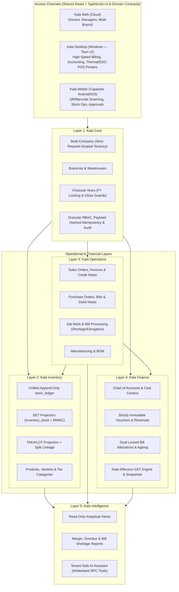

# Kala ERP — Target System & Database Architecture (Stage 0, Rev 3)

> **Status:** Stage 0 Architectural Blueprint — Final Hardened Revision (Design Only — No existing code or migrations modified)  
> **Baseline:** `404Vardan/kala-textiles` (Migrations `001`–`010`, React 19 + TypeScript + Vite 7 + Supabase PostgreSQL + Capacitor)  
> **Target Audience:** All textile businesses (wholesalers/traders, manufacturers, dyeing & printing mills, embroidery units, and textile agents) across **Kala Web**, **Kala Desktop**, and **Kala Mobile**.

---

## 1. Five-Layer Product Architecture

Kala ERP evolves from the existing wholesale catalog, QR ordering, and multi-location stock platform into a unified five-layer system sharing **one PostgreSQL/Supabase data contract** and **one TypeScript domain layer** across Web, Desktop, and Mobile.



### Non-Negotiable Security & Engineering Standards
1. **Preserve Existing Production Capabilities:** Public QR URLs (`/:slug/p/:designNo`), buyer order requests (`submit_order_request`), atomic stock transfers/deductions, and RLS tenant isolation remain 100% backward-compatible.
2. **`SECURITY DEFINER` Function Contract:** Every privileged RPC MUST declare `SECURITY DEFINER`, pin `SET search_path = public, pg_temp`, revoke execution from `PUBLIC` and `anon`, explicitly verify `auth.uid() IS NOT NULL`, validate `p_business_id` membership, and enforce `public.has_permission(p_business_id, '<permission>')` on the server—never trusting UI visibility.
3. **Immutable Ledgers & Audit Trail:** `stock_ledger`, posted `vouchers` + `voucher_entries`, and `audit_events` are strictly append-only. `audit_events.actor_user_id` is always derived server-side from `auth.uid()`.
4. **No Stage Ships Without Automated Verification:** Every stage requires passing SQL/integration tests for isolation, concurrency, reconciliation, and zero regressions before sign-off.

---

## 2. Current Baseline vs. Target ERP

| Capability | Existing Kala (`001`–`010` + Phase 2 UI) | Target Kala ERP |
| :--- | :--- | :--- |
| **Tenancy & Auth** | `businesses`, `memberships` (`owner`/`staff`), `/signup`, `/reset-password`, team invite Edge Function | Request-scoped multi-company isolation + explicit `p_business_id` on RPCs, `branches`, locked `financial_years`, granular RBAC (`roles`/`role_permissions`), `audit_events`, payload-hashed `idempotency_keys` |
| **Catalog & QR** | `products`, `product_media`, tenant-scoped Storage, permanent QR labels, public product page | + `product_variants` (color/size), HSN codes, date-effective `tax_categories`/`tax_rates`, multi-tier price lists |
| **Inventory** | `inventory_locations`, `inventory_stock` (sets/pcs), `stock_movements` | **Unified `stock_ledger`** backing `inventory_stock` (`SET` + MWAC) and `inventory_takas` (`TAKA`/`LOT` + split lineage + specific cost) with 3-way reconciliation |
| **Operations** | Buyer QR `order_requests`, wholesale `orders`, `invoices`, `parties`, `agents` | Full Sales & Purchase lifecycle, Sales/Purchase Returns, Job Work Challans, Mill Processing, Shortage/Elongation, BOM/Manufacturing |
| **Finance** | Order/invoice totals only | Immutable double-entry accounting: Chart of Accounts, Cost Centres, Multi-Currency readiness, Vouchers, Reversal Vouchers, Dual-Locked Bill Allocations, Ledgers, Trial Balance, P&L, Balance Sheet, complete Indian GST engine |
| **Clients** | React 19 + Vite Web + Capacitor Android + Phase 2 flat ERP UI | + Windows Desktop (**Tauri v2**) with silent thermal printing, `row_version` optimistic concurrency, and draft-only offline sync |

---

## 3. Layer 1 — Kala Core (Strict Multi-Company Tenancy, Branches, FY & RBAC)

### 3.1 Multi-Company Resolution & RLS Isolation
`public.is_business_member(business_id)` alone is **insufficient** for multi-company users because it permits a query in Company A's tab to read or mutate Company B's rows.

**Strict Enforcement Rules:**
1. **Request-Scoped Company Resolution (`public.current_business_id()`):**
   - Reads `x-business-id` from `current_setting('request.headers', true)::jsonb->>'x-business-id'`.
   - If present: validates it is a positive integer AND `EXISTS (SELECT 1 FROM public.memberships WHERE user_id = auth.uid() AND business_id = v_header_biz)`. If invalid or unauthorized → returns `NULL` (**fail closed**).
   - If absent: returns the sole `business_id` ONLY when `COUNT(*) = 1` in `public.memberships` (preserving 100% compatibility with single-company users and existing tests). For multi-company users with no header → returns `NULL` (**fail closed**).
2. **Strict Tenant-Scoped RLS on Every Table:**
   - Every tenant-scoped `SELECT`, `INSERT`, `UPDATE`, and `DELETE` policy enforces:
     ```sql
     business_id = public.current_business_id()
     ```
     (where `current_business_id()` has already validated membership against `auth.uid()`). A multi-company user with two browser tabs open cannot leak reads or writes between companies.
3. **Explicit `p_business_id` on All Critical Transactional RPCs:**
   - Privileged RPCs (`confirm_sales_invoice_tx`, `transfer_stock_tx`, `post_voucher_tx`, `close_financial_year_tx`, etc.) accept an explicit `p_business_id BIGINT`, verify `auth.uid() IS NOT NULL`, verify `public.is_business_member(p_business_id)`, and verify `public.has_permission(p_business_id, '<perm>')`—never relying solely on ambient HTTP headers.

### 3.2 Branches, Financial Years & Document Numbering
- **`branches`**: `(id, business_id, code, name, gstin, state_code, address, is_default, is_active)`. `inventory_locations.branch_id` links each godown/shop floor to a branch.
- **`financial_years`**: `(id, business_id, label TEXT, start_date DATE, end_date DATE, is_active BOOLEAN, is_locked BOOLEAN)` with non-overlapping constraint `EXCLUDE USING gist (business_id WITH =, daterange(start_date, end_date, '[]') WITH &&)`.
  - **FY Lock Trigger:** Rejects any `INSERT`/`UPDATE`/`DELETE` on `vouchers`, `voucher_entries`, `sales_invoices`, `purchase_bills`, or `stock_ledger` dated outside an open FY or inside a locked FY.
  - **FY Close Pre-Checks (`close_financial_year_tx`):** Blocks closing if unposted drafts or pending unallocated settlements exist in that FY (unless explicitly resolved/cancelled first), reconciles opening balances (`SUM(DR) = SUM(CR)`), transfers Net Profit/Loss to Reserves/Capital, seeds next FY opening balances, and sets `is_locked = TRUE`.
- **Document Numbering (`business_document_counters`):**
  - Scoped by `(business_id, branch_id, fy_id, doc_type)` using transactional row locks.
  - **Guarantee:** **Unique, strictly ordered document numbering** within each `(company, branch, financial_year, doc_type)` with full cancellation history preserved. Cancelled numbers are **never reused** (and we do not falsely promise gap-free numbering in the presence of cancellations or rolled-back transactions).

### 3.3 Granular RBAC, Payload-Hashed Idempotency & Immutable Audit
- **RBAC:** `roles (id, business_id, name, is_system)` + `role_permissions (role_id, permission_key)` + `public.has_permission(p_business_id, p_permission_key)` enforced inside every privileged RPC. Existing `memberships.role` (`owner | staff`) stays mapped to system roles for backward compatibility.
- **Payload-Hashed Idempotency (`idempotency_keys`):**
  - `(business_id BIGINT, idempotency_key UUID, action_type TEXT, request_hash TEXT NOT NULL, response_json JSONB, created_at TIMESTAMPTZ, PRIMARY KEY (business_id, idempotency_key))`.
  - If the same `idempotency_key` is sent again with the **same `request_hash`**, return `response_json` without re-executing.
  - If the same `idempotency_key` is reused with a **different `request_hash`**, reject with an explicit `Idempotency key conflict` error.
- **Immutable Audit (`audit_events`):**
  - `(id, business_id, actor_user_id UUID NOT NULL DEFAULT auth.uid(), entity_type, entity_id, action, before_json, after_json, created_at)`. `UPDATE` and `DELETE` revoked from all roles; `actor_user_id` is always populated from `auth.uid()`.

---

## 4. Layer 2 — Kala Inventory (Unified Ledger, Taka Lineage & Valuation)

### 4.1 Unified Append-Only `stock_ledger`
All `SET`, `PIECE`, and `TAKA`/`METER` movements write to one immutable ledger:

```sql
stock_ledger (
  id                      BIGINT GENERATED ALWAYS AS IDENTITY PRIMARY KEY,
  business_id             BIGINT NOT NULL,
  branch_id               BIGINT NOT NULL,
  fy_id                   BIGINT NOT NULL,
  transaction_group_id    UUID NOT NULL,          -- Groups all rows of one atomic operation (e.g., transfer out + in)
  reversal_of_id          BIGINT NULL REFERENCES public.stock_ledger(id),
  product_id              BIGINT NOT NULL,
  variant_id              BIGINT NULL,
  lot_id                  BIGINT NULL,
  taka_id                 BIGINT NULL,
  location_id             BIGINT NOT NULL,
  movement_type           TEXT NOT NULL,          -- INTAKE, PURCHASE_IN, TRANSFER_OUT, TRANSFER_IN, DISPATCH, RETURN_IN, RETURN_OUT, JOB_OUT, JOB_IN, SPLIT_OUT, SPLIT_IN, PRODUCTION_CONSUME, PRODUCTION_OUT, ADJUSTMENT
  movement_date           DATE NOT NULL,
  qty_delta               NUMERIC(12,3) NOT NULL, -- +inward / -outward in base UOM
  pcs_delta               INT NOT NULL DEFAULT 0,
  uom                     TEXT NOT NULL CHECK (uom IN ('SET','PCS','MTR','KG')),
  unit_cost               NUMERIC(12,4) NOT NULL DEFAULT 0,
  value_delta             NUMERIC(14,2) NOT NULL DEFAULT 0,
  ref_doc_type            TEXT NOT NULL,
  ref_doc_id              BIGINT NOT NULL,
  source_document_line_id BIGINT NULL,
  idempotency_key         UUID NULL,
  created_by              UUID NOT NULL,          -- Server-derived auth.uid()
  posted_at               TIMESTAMPTZ NOT NULL DEFAULT NOW(),
  notes                   TEXT
)
```

- **Atomic Stock Transfers:** Transferring 100 m (or 10 sets) from Godown A to Godown B generates **two linked rows** sharing one `transaction_group_id`:
  1. `location_id = Godown A`, `movement_type = 'TRANSFER_OUT'`, `qty_delta = -100`, `unit_cost = source_cost`
  2. `location_id = Godown B`, `movement_type = 'TRANSFER_IN'`, `qty_delta = +100`, `unit_cost = source_cost`
  Both commit or roll back together, preserving inventory cost across locations.
- **Negative Stock Prevention:** `CHECK (sets >= 0 AND total_pcs >= 0)` on `inventory_stock` and `CHECK (current_meters >= 0)` on `inventory_takas`, verified under `FOR UPDATE` row locks in deterministic `ORDER BY id ASC` before any outward deduction.

### 4.2 Taka Lineage & Splitting Model
- **`inventory_lots`**: `(id, business_id, product_id, variant_id, lot_no, supplier_party_id, mill_party_id, shade_no, gsm, width_inches, landed_cost_per_unit, received_date)`.
- **`inventory_takas`**: `(id, business_id, lot_id, parent_taka_id NULL REFERENCES inventory_takas(id), product_id, variant_id, location_id, taka_no, barcode_value, initial_meters NUMERIC(10,2), current_meters NUMERIC(10,2), weight_kg NUMERIC(10,3), status CHECK (status IN ('in_stock','reserved','in_process','split','dispatched','consumed','damaged')), row_version INT DEFAULT 1)`.
- **`taka_splits`**: `(id, business_id, parent_taka_id, child_taka_id, meters_allocated NUMERIC(10,2), transaction_group_id UUID, created_by UUID, created_at TIMESTAMPTZ)`.
  - Splitting a 48 m roll (`TK-001`) into 15 m (`TK-001-A`) and 33 m (`TK-001-B`) marks `TK-001` as `status = 'split'`, `current_meters = 0`, creates both child rolls referencing `parent_taka_id = TK-001`, writes `taka_splits` rows, and logs balanced `SPLIT_OUT` (-48 m) + `SPLIT_IN` (+15 m, +33 m) entries in `stock_ledger` under one `transaction_group_id` at the same `unit_cost`.

### 4.3 Valuation Policy & Backdated Posting Guard
- **`TAKA` / `LOT` Valuation:** **Specific Identification** (`taka.current_meters * lot.landed_cost_per_unit`).
- **`SET` / `PIECE` Valuation:** **Moving Weighted Average Cost (MWAC)** on `inventory_stock.avg_unit_cost` updated on inward receipts and frozen into `stock_ledger.unit_cost` on outward dispatches.
- **Backdated Posting Rule (Initial Policy):**
  - Users may save backdated **drafts**, but **posting** a stock movement with `movement_date < MAX(movement_date)` of already-posted movements for the same `(business_id, product_id, location_id)` is **rejected** by the posting RPC. This prevents retroactive corruption of MWAC and historical COGS. Corrections are posted as current-dated adjustment or return entries.
- **Three-Way Reconciliation (`verify_inventory_integrity(p_business_id)`):**
  1. **Set/Piece Quantity Reconciliation:** `SUM(stock_ledger.qty_delta)` = `inventory_stock.sets` per `(product_id, location_id)`.
  2. **Physical Roll Quantity Reconciliation:** `SUM(stock_ledger.qty_delta)` = `inventory_takas.current_meters` per `taka_id`.
  3. **Valuation Reconciliation:** `SUM(stock_ledger.value_delta)` = total closing stock valuation across `inventory_stock` + `inventory_takas`.

---

## 5. Layer 4 — Kala Finance (Truly Immutable Accounting & Complete GST Engine)

### 5.1 Chart of Accounts, Cost Centres & Multi-Currency Readiness
- **`accounts`**: `(id, business_id, code, name, account_group IN ('asset','liability','equity','income','expense'), sub_group, party_id NULL, opening_balance NUMERIC(14,2), opening_balance_type IN ('DR','CR'), is_system)`. Opening balance totals are validated via `verify_opening_balances(p_business_id, p_fy_id)` (`SUM(DR) = SUM(CR)`).
- **`cost_centers`**: `(id, business_id, code, name, is_active)` for branch, mill, or product-line profitability tracking.
- **`vouchers`**: `(id, business_id, branch_id, fy_id, voucher_no, voucher_type IN ('SALES','PURCHASE','SALES_RETURN','PURCHASE_RETURN','RECEIPT','PAYMENT','JOURNAL','CONTRA','REVERSAL'), voucher_date, currency_code CHAR(3) DEFAULT 'INR', exchange_rate NUMERIC(14,6) DEFAULT 1.0, ref_doc_type, ref_doc_id, reversed_voucher_id NULL REFERENCES vouchers(id), narration, total_amount NUMERIC(14,2), base_total_amount NUMERIC(14,2), status IN ('draft','posted'), created_by UUID, posted_at TIMESTAMPTZ)`.
- **`voucher_entries`**: `(id, business_id, voucher_id, account_id, cost_center_id NULL, debit NUMERIC(14,2) DEFAULT 0, credit NUMERIC(14,2) DEFAULT 0, base_debit NUMERIC(14,2) DEFAULT 0, base_credit NUMERIC(14,2) DEFAULT 0, CHECK (debit >= 0 AND credit >= 0 AND NOT (debit > 0 AND credit > 0) AND (debit > 0 OR credit > 0)))`.

### 5.2 Strictly Immutable Reversals & Dual-Locked Bill Allocations
1. **Zero Mutation of Posted Vouchers:** Once `vouchers.status = 'posted'`, a `BEFORE UPDATE OR DELETE` trigger **unconditionally blocks** all modifications on both `vouchers` and `voucher_entries`—no exceptions.
2. **Separate Reversal Voucher:** `reverse_voucher_tx(p_business_id, p_voucher_id, p_reversal_date, p_reason, p_idempotency_key)` keeps the original voucher permanently `posted`, creates a new `REVERSAL` voucher with `reversed_voucher_id = p_voucher_id` and swapped debit/credit entries.
   - **Single-Reversal Guard:** `CREATE UNIQUE INDEX uq_vouchers_single_reversal ON public.vouchers (business_id, reversed_voucher_id) WHERE reversed_voucher_id IS NOT NULL AND status = 'posted'` guarantees a voucher can never be reversed twice.
3. **Deferred Balance Enforcement:** `CONSTRAINT TRIGGER trg_voucher_balanced AFTER INSERT OR UPDATE OR DELETE ON voucher_entries DEFERRABLE INITIALLY DEFERRED` asserts `SUM(base_debit) = SUM(base_credit) AND SUM(base_debit) > 0` for every posted voucher.
4. **Dual-Side Bill Allocation Locking (`bill_allocations`):**
   - `allocate_bill_payment_tx` locks **both** `invoice_voucher_id` AND `settlement_voucher_id` in deterministic `ORDER BY id ASC FOR UPDATE`, and validates:
     - `SUM(allocated_amount WHERE invoice_voucher_id = X) <= invoice_voucher.total_amount` (cannot over-settle an invoice), AND
     - `SUM(allocated_amount WHERE settlement_voucher_id = Y) <= settlement_voucher.total_amount` (cannot double-spend a receipt/payment across concurrent allocations).

### 5.3 Complete Indian GST Tax Engine
Products do **not** carry a hardcoded `DEFAULT 5.00` tax rate. Instead:
- **`tax_categories`**: `(id, business_id, name, hsn_sac_code, supply_nature IN ('GOODS','SERVICES'), is_exempt, is_nil_rated)`
- **`tax_rates`**: `(id, business_id, tax_category_id, effective_from DATE, effective_to DATE NULL, cgst_rate NUMERIC(5,2), sgst_rate NUMERIC(5,2), igst_rate NUMERIC(5,2), cess_rate NUMERIC(5,2), rate_threshold_amount NUMERIC(12,2) NULL)` — supports historical rate changes and textile price-slab GST thresholds (e.g. apparel <= ₹1,000 vs > ₹1,000).
- **Invoice Tax Determination Inputs:**
  - `place_of_supply_state_code` (resolved from `ship_to` / `bill_to` rules),
  - `supply_type` (`B2B_REGULAR`, `B2C`, `SEZ_WITH_PAY`, `SEZ_WITHOUT_PAY`, `EXPORT_WITH_PAY`, `EXPORT_WITHOUT_PAY`, `EXEMPT`, `NIL_RATED`),
  - `is_reverse_charge BOOLEAN`, `is_tax_inclusive BOOLEAN`,
  - Line & header `discount_amount`, `freight_amount` (taxed at highest applicable line rate or freight SAC rate), `cess_amount`, and `round_off`.
- **Immutable Tax Snapshot (`invoice_tax_snapshots` / line columns):** On invoice confirmation, freeze seller GSTIN/state, buyer GSTIN/state, bill-to/ship-to addresses, place of supply, supply type, reverse-charge flag, HSN, tax category, tax rates, cess, discounts, freight, and taxable/tax amounts so future master edits never alter filed GSTR-1/GSTR-3B numbers.

---

## 6. Layer 3 — Kala Operations & Atomic Document Lifecycle

- **Order vs. Invoice Deduction Rule:** `orders.fulfillment_mode` (`DIRECT_DISPATCH` vs `RESERVE_FOR_INVOICE`) + `sales_invoices.stock_already_deducted` guarantees stock is never deducted twice.
- **Single-Transaction Orchestrators:** Every confirmation (`confirm_sales_invoice_tx`, `confirm_purchase_bill_tx`, `confirm_sales_return_tx`, `confirm_purchase_return_tx`, `issue_job_work_challan_tx`, `receive_job_work_tx`, `complete_production_run_tx`) runs in one PostgreSQL transaction:
  1. Check `idempotency_keys` (with `request_hash` match check).
  2. Validate `auth.uid()`, `p_business_id`, and `has_permission(p_business_id, ...)`.
  3. Lock document `FOR UPDATE`, verify `status = 'draft'` and open FY + chronological stock posting rule.
  4. Lock stock/taka rows in deterministic `ORDER BY id ASC`.
  5. Append `stock_ledger` rows (`transaction_group_id`) and update projections.
  6. Freeze GST tax snapshot and post balanced, immutable `vouchers` + `voucher_entries`.
  7. Transition document to `confirmed` and write `audit_events` + `idempotency_keys`.

---

## 7. Layer 5 — Kala Intelligence

- **Read-Only Analytical Views:** Fast/slow designs, gross margin per design/lot (from frozen `stock_ledger.unit_cost`), overdue ageing (from `bill_allocations`), mill shrinkage/shortage %.
- **AI Assistant (`kala-ai-assistant` Edge Function):** Strictly invokes whitelisted, tenant-scoped, read-only SQL RPCs—never LLM-generated raw SQL.

---

## 8. Desktop (Tauri v2) & Offline Synchronisation Protocol

- **Desktop Choice:** **Tauri v2** (~8–15 MB installer, low RAM on shop PCs, native Rust silent Windows spooler + ESC/POS + TSC/Zebra TSPL/ZPL thermal printing, USB HID barcode scanner, local SQLite cache) behind `src/platform/bridge.ts`.
- **Hardened Offline Protocol:**
  1. **Draft-Only Offline Boundary:** Offline devices may read cached masters and create/edit **Drafts** & **Scan Batches**. Authoritative confirmations (stock deductions, voucher postings, sequential invoice/voucher numbers, FY close) execute **only on the server**.
  2. **Payload-Hashed Idempotency:** Every synced draft submission includes a deterministic `client_draft_id` + `idempotency_key` + `request_hash` so duplicate retries never create duplicate drafts.
  3. **Optimistic Concurrency (`row_version`):** Master records (`products`, `parties`, `agents`) and drafts carry `row_version INT`. Stale updates fail with `409 Conflict` and prompt explicit user resolution rather than silently overwriting concurrent edits.

---

## 9. Commercial Model Readiness (SaaS vs. Enterprise)

- `subscription_plans` + `business_subscriptions` + server-side `has_module(p_business_id, p_module_key)` support both SaaS subscriptions (hosted Supabase Cloud) and Enterprise deployments (dedicated/self-hosted Supabase PostgreSQL) from one codebase.

---

## 10. Stage 1–8 Roadmap & Mandatory Automated Exit Gates

No stage is considered complete merely because its UI works. Every stage must pass **automated SQL + integration tests** before advancing:

| Stage | Focus | Planned Migrations | Mandatory Exit Test Gates |
| :---: | :--- | :---: | :--- |
| **0** | **Architecture Blueprint** | *(None — this doc)* | Approved Rev 3 architecture sign-off. |
| **1** | **Kala Core** | `011`–`014` | Cross-company isolation (multi-company user with 2 headers + missing header fail-closed), RBAC RPC enforcement, FY lock guard, idempotency payload-hash conflict test, existing QR URLs & buyer order requests regression tests. |
| **2** | **Unified Inventory & Valuation** *(highest migration risk)* | `015`–`019` | Concurrent stock deduction race test, atomic 2-row transfer cost preservation, backdated posting block, taka split lineage integrity, 3-way `verify_inventory_integrity()` reconciliation, existing `intake_stock_tx`/`transfer_stock_tx` regression tests. |
| **3** | **Accounting Engine** | `020`–`024` | Balanced voucher deferred trigger, posted-voucher immutability (rejects UPDATE/DELETE), single-reversal uniqueness guard, dual-locked concurrent bill allocation test, opening-balance & FY close guard tests. |
| **4** | **Sales, Purchases & GST** | `025`–`030` | Duplicate invoice confirmation idempotency test, order-to-invoice no-double-deduction test, GST determination suite (intra/inter-state, SEZ, export, reverse charge, exempt, tax-inclusive, discount/freight, rate-change snapshot immutability). |
| **5** | **Job Work & Manufacturing** | `031`–`035` | Mill-wise stock balance accuracy, shortage/elongation calculation, landed cost rollup into finished lots, BOM consumption & valuation reconciliation. |
| **6** | **Financial Reports, Desktop & Mobile** | `036`–`038` | Trial Balance / P&L / Balance Sheet tie-out (`Assets = Liabilities + Equity + Net Profit`), GSTR-1/3B reconciliation, Tauri thermal print & `row_version` offline conflict tests. |
| **7** | **Intelligence & Compliance** | `039`–`041` | Read-only AI RPC tenant isolation tests, E-Invoice / E-Way Bill Edge Function contract tests. |
| **8** | **Commercial Launch** | `042`–`043` | Module gating (`has_module`) enforcement tests, backup/restore & multi-tenant load verification. |
