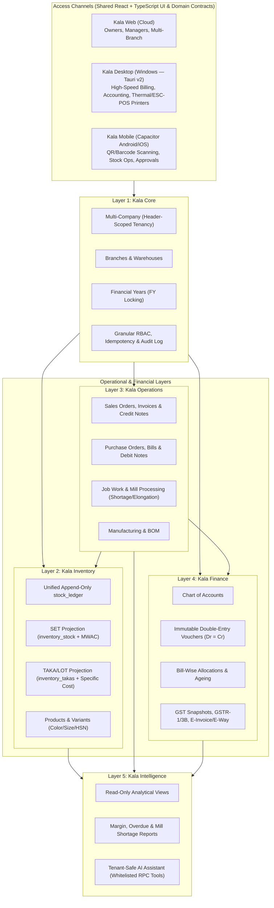

# Kala ERP — Target System & Database Architecture (Stage 0, Rev 2)

> **Status:** Stage 0 Architectural Blueprint — Hardened after Technical Architecture Review (Design Only — No existing code or migrations modified)  
> **Baseline:** `404Vardan/kala-textiles` (Migrations `001`–`010`, React 19 + TypeScript + Vite 7 + Supabase PostgreSQL + Capacitor)  
> **Target Audience:** All textile businesses (wholesalers/traders, manufacturers, dyeing & printing mills, embroidery units, and textile agents) across **Kala Web**, **Kala Desktop**, and **Kala Mobile**.

---

## 1. Five-Layer Product Architecture

Kala ERP evolves from the existing wholesale catalog, QR ordering, and multi-location stock platform into a unified five-layer system sharing **one PostgreSQL/Supabase data contract** and **one TypeScript domain layer** across Web, Desktop, and Mobile.



### Non-Negotiable Architectural Invariants
1. **Preserve Existing Production Capabilities:** Public QR URLs (`/:slug/p/:designNo`), buyer order requests (`submit_order_request`), atomic stock transfers/deductions, and RLS tenant isolation remain 100% backward-compatible.
2. **One Stock Ledger & One Accounting Ledger:** Every inventory mutation appends to `stock_ledger`; every financial event posts an immutable, balanced double-entry voucher.
3. **Single-Transaction Document Confirmation:** Confirming an invoice, purchase bill, return, or job-work receipt updates stock, valuation, and accounting inside **one PostgreSQL transaction**—never across multiple client API calls.
4. **Stateless Multi-Company Scoping:** Active company selection is sent per request (`x-business-id` header / explicit RPC argument), preventing cross-tab tenant leakage.

---

## 2. Current Baseline vs. Target ERP

| Capability | Existing Kala (`001`–`010` + Phase 2 UI) | Target Kala ERP |
| :--- | :--- | :--- |
| **Tenancy & Auth** | `businesses`, `memberships` (`owner`/`staff`), `/signup`, `/reset-password`, team invite Edge Function | Request-scoped multi-company switching, `branches`, locked `financial_years`, granular RBAC (`roles`/`role_permissions`), `audit_events`, `idempotency_keys` |
| **Catalog & QR** | `products`, `product_media`, tenant-scoped Storage, permanent QR labels, public product page | + `product_variants` (color/size), HSN codes, GST rates, multi-tier wholesale price lists |
| **Inventory** | `inventory_locations`, `inventory_stock` (sets/pcs), `stock_movements` | **Unified `stock_ledger`** backing both `inventory_stock` (`SET` + MWAC) and `inventory_takas` (`TAKA`/`LOT` + specific cost) with reconciliation RPC |
| **Operations** | Buyer QR `order_requests`, wholesale `orders`, `invoices`, `parties`, `agents` | Full Sales & Purchase lifecycle, Sales/Purchase Returns, Job Work Challans, Mill Processing, Shortage/Elongation, BOM/Manufacturing |
| **Finance** | Order/invoice totals only | Immutable double-entry accounting: Chart of Accounts, Vouchers, Reversals, Bill-wise Allocations, Cash/Bank Books, Ledgers, Trial Balance, P&L, Balance Sheet, GST/E-Invoice/E-Way |
| **Clients** | React 19 + Vite Web + Capacitor Android + Phase 2 flat ERP UI | + Windows Desktop (**Tauri v2**) with silent thermal printing, optimistic concurrency (`row_version`), and draft-only offline sync |

---

## 3. Layer 1 — Kala Core (Safe Multi-Tenancy, Branches, Financial Years & RBAC)

### 3.1 Multi-Company Switching Without Cross-Tab Leakage
**Why a DB `user_preferences.active_business_id` column is unsafe:** If an owner opens Company A in Browser Tab 1 and switches to Company B in Browser Tab 2, a server-side `active_business_id` row mutates Tab 1's context silently. Tab 1's next `INSERT` (relying on `DEFAULT public.current_business_id()`) would write into Company B.

**Hardened Request-Scoped Resolution:**
1. The frontend stores the selected company ID per browser tab/session (`sessionStorage` with `localStorage` initial default) and attaches it as an HTTP header (`x-business-id: <id>`) on every Supabase client call.
2. `public.current_business_id()` resolves deterministically:
   ```sql
   -- 1. Check request header x-business-id (validated against memberships)
   -- 2. Fallback: if user has exactly 1 row in memberships, return that business_id
   -- 3. Otherwise return NULL (fail closed)
   ```
3. **RLS Write Protection:**
   - `SELECT` policies continue using `public.is_business_member(business_id)` (or `business_id = public.current_business_id()` so Tab 1 only sees Company A's rows).
   - `INSERT` / `UPDATE` / `DELETE` policies enforce `business_id = public.current_business_id()` AND `public.is_business_member(business_id)`, guaranteeing Tab 1 can never read or write Company B even while Tab 2 is active on Company B.
   - Single-company users and existing tests (`isolation.sql`) continue working with zero breaking changes because of the `COUNT(*) = 1` fallback.
4. **Optional `user_preferences`** stores only UI defaults (last opened company/branch on fresh login)—never used by RLS or SQL defaults.

### 3.2 Branches, Financial Years & Document Counters
- **`branches`**: `(id, business_id, code, name, gstin, state_code, address, is_default, is_active)` — `inventory_locations.branch_id` links each godown/shop floor to a branch.
- **`financial_years`**: `(id, business_id, label TEXT, start_date DATE, end_date DATE, is_active BOOLEAN, is_locked BOOLEAN)`
  - Non-overlapping date range constraint (`EXCLUDE USING gist` on `(business_id WITH =, daterange(start_date, end_date, '[]') WITH &&)`).
  - **FY Lock Guard Trigger:** Rejects any `INSERT`/`UPDATE`/`DELETE` on `vouchers`, `voucher_entries`, `sales_invoices`, `purchase_bills`, or `stock_ledger` whose document date falls in a locked FY or outside any defined FY.
- **`business_document_counters`**: Scoped by `(business_id, branch_id, fy_id, doc_type)` using `INSERT ... ON CONFLICT DO UPDATE` row locks so GST invoice sequences remain strictly monotonic and gap-free.

### 3.3 Granular RBAC, Idempotency & Audit Trail
- **`roles` & `role_permissions`**: Preserve `memberships.role` (`owner | staff`) for backward compatibility while adding `memberships.role_id` pointing to `roles` (`Owner`, `Manager`, `Accountant`, `Inventory Staff`, `Sales Staff`) checked via `public.has_permission(p_business_id, p_permission_key)`.
- **`idempotency_keys`**: `(business_id, idempotency_key UUID, action_type, response_json JSONB, created_at, PRIMARY KEY (business_id, idempotency_key))` — prevents duplicate stock deductions or double-posted vouchers on network retries.
- **`audit_events`**: Append-only table `(id, business_id, actor_user_id, entity_type, entity_id, action, before_json, after_json, created_at)` with `UPDATE`/`DELETE` revoked from all roles.

---

## 4. Layer 2 — Kala Inventory (Unified Ledger + Valuation & Reconciliation)

### 4.1 Single Source of Truth: `stock_ledger`
Instead of maintaining two disconnected movement engines (`stock_movements` for Sets and `taka_movements` for Takas), **every** inventory event across the entire ERP writes to one append-only **`stock_ledger`** table:

```sql
stock_ledger (
  id              BIGINT GENERATED ALWAYS AS IDENTITY PRIMARY KEY,
  business_id     BIGINT NOT NULL,
  branch_id       BIGINT NOT NULL,
  fy_id           BIGINT NOT NULL,
  product_id      BIGINT NOT NULL,
  variant_id      BIGINT NULL,
  lot_id          BIGINT NULL,
  taka_id         BIGINT NULL,
  location_id     BIGINT NOT NULL,
  movement_type   TEXT NOT NULL, -- INTAKE, PURCHASE_IN, TRANSFER_OUT, TRANSFER_IN, DISPATCH, RETURN_IN, RETURN_OUT, JOB_OUT, JOB_IN, PRODUCTION_CONSUME, PRODUCTION_OUT, ADJUSTMENT
  qty_delta       NUMERIC(12,3) NOT NULL, -- +inward / -outward (in product's base UOM)
  pcs_delta       INT NOT NULL DEFAULT 0,
  uom             TEXT NOT NULL CHECK (uom IN ('SET','PCS','MTR','KG')),
  unit_cost       NUMERIC(12,4) NOT NULL DEFAULT 0, -- Frozen cost at movement time
  value_delta     NUMERIC(14,2) NOT NULL DEFAULT 0, -- ROUND(qty_delta * unit_cost, 2)
  ref_doc_type    TEXT NOT NULL,
  ref_doc_id      BIGINT NOT NULL,
  staff_name      TEXT,
  notes           TEXT,
  created_at      TIMESTAMPTZ NOT NULL DEFAULT NOW()
)
```

- **Strict Immutability:** `UPDATE` and `DELETE` on `stock_ledger` are revoked; corrections append offsetting `ADJUSTMENT` or `RETURN` rows.
- **Backward Compatibility:** Existing `stock_movements` rows are migrated/bridged into `stock_ledger` during Stage 2, and `stock_movements` can remain as a read-only compatibility view if needed.

### 4.2 Fast Current-State Projections (Never Edited Directly)
1. **Set/Piece Projection (`inventory_stock` — existing table extended):**
   - Adds `reserved_sets INT DEFAULT 0`, `avg_unit_cost NUMERIC(12,4) DEFAULT 0`, `row_version INT DEFAULT 1`.
   - Updated **exclusively** inside transactional inventory RPCs in the same transaction that appends to `stock_ledger`.
2. **Lot & Serialized Taka Projection (`inventory_lots` & `inventory_takas`):**
   - `inventory_lots`: `(id, business_id, product_id, variant_id, lot_no, supplier_party_id, mill_party_id, shade_no, gsm, width_inches, landed_cost_per_unit, received_date)`.
   - `inventory_takas`: `(id, business_id, lot_id, product_id, variant_id, location_id, taka_no, barcode_value, initial_meters, current_meters, weight_kg, status CHECK (status IN ('in_stock','reserved','in_process','dispatched','consumed','damaged')), row_version)`.
   - **Taka Splitting/Cutting:** Cutting 15 m from a 48 m taka appends `-15` m (`DISPATCH` or `CUT_OUT`) to `stock_ledger` against `taka_id` and decrements `inventory_takas.current_meters` to `33` m inside one locked transaction.

### 4.3 Valuation & Reconciliation Strategy
- **Valuation Rules (Deterministic & Auditable):**
  - `tracking_mode = 'TAKA'`: **Specific Identification** — each taka is valued at `taka.current_meters * lot.landed_cost_per_unit` (including grey cloth cost + capitalized mill processing cost).
  - `tracking_mode = 'SET' | 'PIECE'`: **Moving Weighted Average Cost (MWAC)** — on every inward movement:
    $$\text{new\_avg\_cost} = \frac{(\text{old\_qty} \times \text{old\_avg\_cost}) + (\text{in\_qty} \times \text{in\_unit\_cost})}{\text{old\_qty} + \text{in\_qty}}$$
    Every outward movement (`DISPATCH`) records `unit_cost = current avg_unit_cost` on `stock_ledger` so historical Cost of Goods Sold (COGS) never shifts retroactively.
- **Automated Reconciliation (`verify_inventory_integrity(p_business_id)`):**
  - Asserts `SUM(stock_ledger.qty_delta)` equals `inventory_stock.sets` for every `SET` product/location and equals `inventory_takas.current_meters` for every `TAKA`. Run in CI/tests and owner health checks.

---

## 5. Layer 4 — Kala Finance (Strict Accounting Integrity & GST)

### 5.1 Chart of Accounts & Immutable Double-Entry Vouchers
- **`accounts`**: `(id, business_id, code, name, account_group IN ('asset','liability','equity','income','expense'), sub_group, party_id NULL, opening_balance, opening_balance_type IN ('DR','CR'), is_system)`.
- **`vouchers`**: `(id, business_id, branch_id, fy_id, voucher_no, voucher_type IN ('SALES','PURCHASE','SALES_RETURN','PURCHASE_RETURN','RECEIPT','PAYMENT','JOURNAL','CONTRA','REVERSAL'), voucher_date, ref_doc_type, ref_doc_id, reversed_voucher_id NULL, narration, total_amount, status IN ('draft','posted','reversed'), posted_by, posted_at)`.
- **`voucher_entries`**: `(id, business_id, voucher_id, account_id, debit NUMERIC(14,2) DEFAULT 0, credit NUMERIC(14,2) DEFAULT 0, CHECK (debit >= 0 AND credit >= 0 AND NOT (debit > 0 AND credit > 0) AND (debit > 0 OR credit > 0)))`.

### 5.2 Hard Accounting Invariants (Database-Enforced)
1. **Deferred Balance Constraint Trigger:** `CONSTRAINT TRIGGER trg_voucher_balanced AFTER INSERT OR UPDATE OR DELETE ON voucher_entries DEFERRABLE INITIALLY DEFERRED` rejects commit if any `posted` voucher has `SUM(debit) <> SUM(credit)` or `SUM(debit) <= 0`.
2. **Post-Immutability & Reversal-Only Corrections:** A `BEFORE UPDATE OR DELETE` trigger on `vouchers` and `voucher_entries` blocks all mutations once `vouchers.status = 'posted'` (except setting `status = 'reversed'` exclusively inside `reverse_voucher_tx(p_voucher_id)`). Corrections must post a linked `REVERSAL` voucher (swapping debits and credits) or a Credit/Debit Note.
3. **Bill-Wise Allocation Locking:** `bill_allocations (id, business_id, settlement_voucher_id, invoice_voucher_id, allocated_amount)` locks `invoice_voucher_id` `FOR UPDATE`, verifies same `business_id` and same party account, and enforces `SUM(allocated_amount) <= invoice_voucher.total_amount` so concurrent receipts can never over-allocate a bill.
4. **Immutable GST Snapshots:** At invoice confirmation, each line freezes `hsn_code`, `taxable_value`, `cgst_rate`, `cgst_amount`, `sgst_rate`, `sgst_amount`, `igst_rate`, `igst_amount`, and header `round_off`. Future changes to `products.gst_rate` or `parties.gst_number` never alter historical GST filings (GSTR-1/GSTR-3B).
5. **Financial-Year Locking & Closing RPC:** `close_financial_year_tx(p_fy_id)` locks the FY (`is_locked = true`), computes closing balances of all Balance Sheet accounts, transfers Net Profit/Loss to Retained Earnings/Capital, and seeds the opening balances for the next FY atomically.

---

## 6. Layer 3 — Kala Operations & Atomic Document Lifecycle

### 6.1 Order vs. Invoice Stock Deduction Rule (Preventing Double-Deduction)
Existing Kala deducts stock when confirming a wholesale order (`confirm_order_and_deduct_stock_tx`). When `sales_invoices` are added, stock must **never** be deducted twice:
- **Rule:**
  - `orders` gain `fulfillment_mode TEXT DEFAULT 'DIRECT_DISPATCH' CHECK (fulfillment_mode IN ('DIRECT_DISPATCH', 'RESERVE_FOR_INVOICE'))`.
  - When a `sales_invoice` is created from an order that already ran `DIRECT_DISPATCH`, `sales_invoices.stock_already_deducted = TRUE` (confirmation posts only the financial voucher, skipping stock deduction).
  - For new ERP workflows using `RESERVE_FOR_INVOICE`, confirming an Order increments `inventory_stock.reserved_sets` (or sets `taka.status = 'reserved'`), and confirming the **Sales Invoice** releases the reservation, appends `DISPATCH` to `stock_ledger`, and posts the `SALES` voucher atomically.

### 6.2 Single-Transaction Orchestrator Pattern
Every state transition executes inside **one `SECURITY DEFINER` PostgreSQL RPC** (never orchestrated across multiple frontend calls):

```text
confirm_sales_invoice_tx(p_invoice_id, p_location_id, p_idempotency_key)
  1. Check idempotency_keys -> return cached JSON if already processed
  2. Lock sales_invoices row FOR UPDATE; verify status = 'draft' and open financial_year
  3. Lock inventory_stock / inventory_takas rows in ORDER BY id ASC (deadlock-free)
  4. Validate available stock / taka meters; append stock_ledger rows + update projections
  5. Freeze GST tax breakdown (CGST/SGST vs IGST from branch.state_code vs party.state_code)
  6. Insert posted SALES voucher + balanced voucher_entries (Dr Party, Cr Sales, Cr Tax, Cr/Dr Round-off)
  7. Update sales_invoices SET status = 'confirmed', voucher_id = v_voucher_id
  8. Record audit_events + idempotency_keys -> COMMIT (or full ROLLBACK on any error)
```

The exact same single-transaction pattern governs `confirm_purchase_bill_tx`, `confirm_sales_return_tx`, `confirm_purchase_return_tx`, `issue_job_work_challan_tx`, `receive_job_work_tx` (computing shortage/elongation % and landed cost rollup), and `complete_production_run_tx`.

---

## 7. Layer 5 — Kala Intelligence

1. **Analytical Views/RPCs:** Fast/slow moving designs, gross margin per design/lot (powered by frozen `stock_ledger.unit_cost`), overdue receivables ageing (powered by `bill_allocations`), and mill shrinkage/shortage %.
2. **AI Assistant (`kala-ai-assistant` Edge Function):** Uses strict tool-calling against whitelisted, tenant-scoped, read-only SQL RPCs—never LLM-generated raw SQL.

---

## 8. Desktop (Tauri v2) & Offline Synchronisation Protocol

### 8.1 Desktop Wrapper: Tauri v2 (Recommended over Electron)
- **Tauri v2** (~8–15 MB installer, ~60–120 MB RAM on 4–8 GB textile shop PCs) wraps the existing React 19 + Vite 7 build (`dist/`), adding native Rust commands behind `src/platform/bridge.ts` for silent Windows spooler printing, raw ESC/POS & TSC/Zebra TSPL/ZPL barcode label printing, USB HID barcode scanner input, and local SQLite caching.

### 8.2 Hardened Offline & Conflict Resolution Protocol
A naive client sync queue is unsafe for inventory and GST accounting. Kala enforces four strict offline rules:
1. **Draft-Only Offline Boundary:** Offline devices can read cached masters (`products`, `parties`, `agents`) and create/edit **Drafts** (draft orders, draft stock intake scans, QR scan batches). **Authoritative Confirmations** (stock deduction, voucher posting, GST invoice numbering, FY closing) execute **only on the server** when online.
2. **Temporary Local IDs → Server-Assigned Sequences:** Offline drafts carry a client UUID (`client_draft_id`) and display `LOCAL-DRAFT`. Authoritative sequential `order_no` / `invoice_no` / `voucher_no` are assigned strictly by PostgreSQL on sync—preventing GST sequence gaps or collisions.
3. **Idempotency Keys:** Every synced mutation sends its deterministic `p_idempotency_key UUID` so network timeouts or app restarts never double-create drafts or double-post vouchers.
4. **Optimistic Concurrency Control (`row_version`):** Mutable records (`products`, `parties`, `orders`) carry `row_version INT`. Sync updates include `WHERE id = $1 AND row_version = $expected`. If another user modified the record on the server, PostgreSQL returns a conflict error (`409`), and the client displays a side-by-side resolution dialog instead of silently overwriting.

---

## 9. Commercial Model Readiness (SaaS vs. Enterprise)

- **`subscription_plans` & `business_subscriptions`**: Server-side `has_module(business_id, module_key)` gates optional ERP modules (`inventory_taka`, `accounting`, `job_work`, `manufacturing`, `ai_assistant`) and branch/user limits.
- **Single Codebase:** Runs identically on hosted Supabase Cloud (Model B: SaaS) or customer-dedicated/self-hosted Supabase PostgreSQL (Model C: Enterprise / RELY alternative).

---

## 10. Restructured Dependency-Driven Stage Roadmap (Stages 1–8)

To eliminate rework across stages, **Unified Inventory (Stage 2)** and **Accounting Core (Stage 3)** are built *before* **Full Trade Operations (Stage 4)** and **Job Work/Manufacturing (Stage 5)**:

| Stage | Focus | Planned Migrations | Dependencies & Exit Criteria |
| :---: | :--- | :---: | :--- |
| **0** | **Architecture Blueprint** | *(None — this doc)* | Approved hardened architecture (Rev 2) before touching code/schema. |
| **1** | **Kala Core** | `011`–`014` | Header-scoped `current_business_id()`, `branches`, `financial_years` (FY lock), granular `roles`/`permissions`, `idempotency_keys`, `audit_events`, `row_version` columns. |
| **2** | **Unified Inventory Foundation** | `015`–`019` | Append-only `stock_ledger`, `product_variants`, `inventory_lots`, `inventory_takas`, MWAC + specific-cost valuation, taka cutting RPC, `verify_inventory_integrity()` reconciliation test. |
| **3** | **Accounting Core** | `020`–`024` | `accounts` (default Chart of Accounts), immutable `vouchers` + `voucher_entries` (deferred balance trigger), `reverse_voucher_tx`, `bill_allocations`, Receipt/Payment/Journal/Contra vouchers, `close_financial_year_tx`. |
| **4** | **Trade Operations & GST** | `025`–`030` | `sales_invoices`, `sales_returns`, `purchase_orders`, `purchase_bills`, `purchase_returns`, single-tx confirm RPCs posting directly to Stage 2 `stock_ledger` & Stage 3 `vouchers`, frozen GST snapshots, no double-deduction guard. |
| **5** | **Job Work & Manufacturing** | `031`–`035` | `job_work_challans`, `job_work_receipts`, mill-wise stock balance, shortage/elongation % reports, landed cost rollup, `bom_recipes`, `production_runs`. |
| **6** | **Financial Reports, Desktop & Mobile** | `036`–`038` | Cash/Bank Books, Party/Supplier Ledgers, Trial Balance, P&L, Balance Sheet, GSTR-1/3B exports; Tauri v2 Windows desktop wrapper, silent thermal printing, draft-only offline sync with `row_version` conflict handling. |
| **7** | **Intelligence & Compliance** | `039`–`041` | Analytical views (margins, fast/slow stock, overdue ageing, mill shortage), E-Invoice/E-Way Bill Edge Function adapters, read-only tool-calling AI Assistant. |
| **8** | **Commercial Launch** | `042`–`043` | `subscription_plans`, `business_subscriptions`, `has_module()` gating, billing webhooks, enterprise deployment & backup runbooks. |
