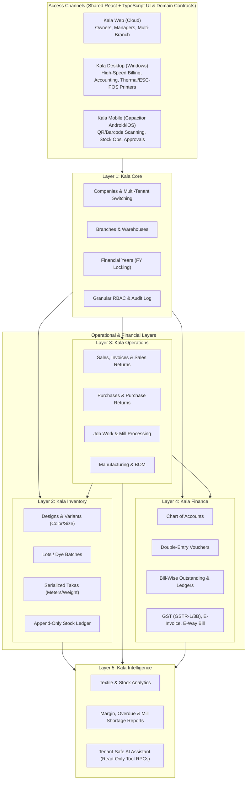
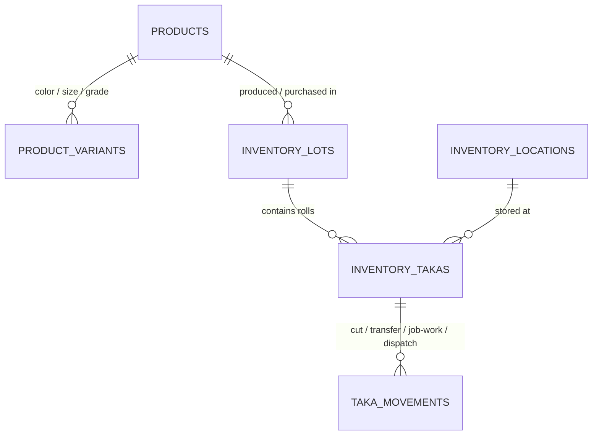
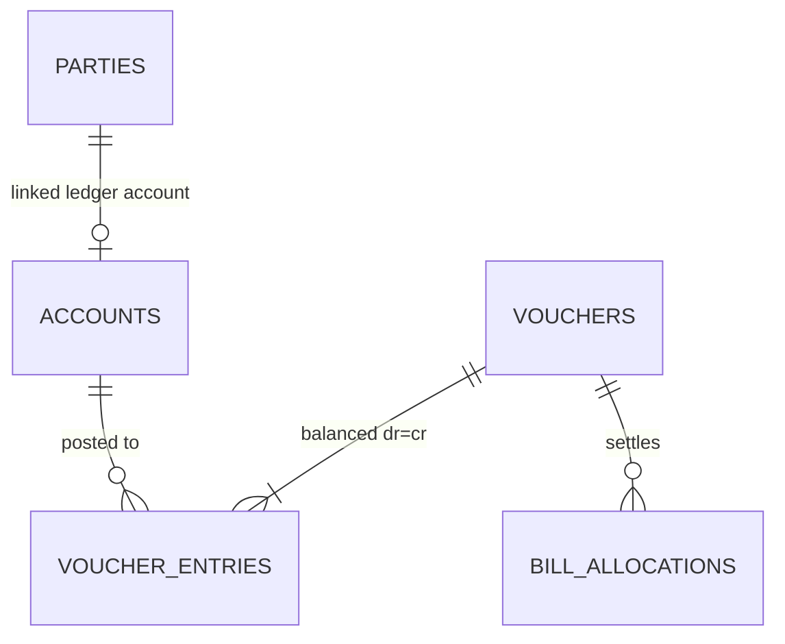

# Kala ERP — Target System & Database Architecture (Stage 0)

> **Status:** Stage 0 Architectural Blueprint (Design Only — No existing code or migrations modified)  
> **Baseline:** `404Vardan/kala-textiles` (Migrations `001`–`010`, React 19 + TypeScript + Vite 7 + Supabase PostgreSQL + Capacitor)  
> **Target Audience:** All textile businesses (wholesalers/traders, manufacturers, dyeing & printing mills, embroidery units, and textile agents) across **Kala Web**, **Kala Desktop**, and **Kala Mobile**.

---

## 1. Five-Layer Product Architecture

Kala ERP evolves from the existing wholesale catalog, QR ordering, and multi-location stock platform into a unified five-layer system sharing **one PostgreSQL/Supabase data contract** and **one TypeScript domain layer** across Web, Desktop, and Mobile.

### Non-Negotiable Architectural Invariants
1. **Preserve Existing Production Capabilities:** Public QR URLs (`/:slug/p/:designNo`), buyer order requests (`submit_order_request`), atomic stock transfers/deductions, and RLS tenant isolation must remain 100% backward-compatible throughout Stages 1–8.
2. **One Ledger, No Split Brains:** Every inventory change writes to an append-only stock ledger; every financial event posts a balanced double-entry voucher. Reports never rely on ad-hoc client calculations.
3. **Server-Enforced Tenancy & Integrity:** Every table carries `business_id` (company), composite foreign keys `(business_id, id)` where applicable, strict RLS, and `SECURITY DEFINER` transactional RPCs with `FOR UPDATE` locks for stock and accounting mutations.
4. **Single Codebase Across Channels:** Web, Desktop, and Mobile consume the same PostgreSQL RPC contracts and TypeScript services—never three diverging codebases.

---

## 2. Current Baseline vs. Target ERP

| Capability | Existing Kala (`001`–`010` + Phase 2 UI) | Target Kala ERP |
| :--- | :--- | :--- |
| **Tenancy & Auth** | `businesses`, `memberships` (`owner`/`staff`), self-service `/signup`, `/reset-password`, team invite Edge Function | Multi-company switching per user, `branches`, `financial_years`, granular RBAC (`roles`/`role_permissions`), `audit_events` |
| **Catalog & QR** | `products`, `product_media`, tenant-scoped Storage, permanent QR labels, public product page | + Color/size variants, HSN codes, GST tax slabs, multi-tier wholesale price lists |
| **Inventory** | `inventory_locations` (`GODOWN`, `SHOP`), `inventory_stock` (sets/pcs), `stock_movements` | Dual-mode engine: **Sets/Pieces** (existing) + **Lots & Serialized Takas** (meters, weight, color, mill location) on one unified ledger |
| **Operations** | Buyer QR `order_requests`, wholesale `orders`, `invoices`, `parties`, `agents` | Full Sales & Purchase lifecycle, Sales/Purchase Returns, Job Work Challans, Mill Processing, Shortage/Elongation tracking, BOM/Manufacturing |
| **Finance** | Order/invoice totals only | Full double-entry accounting: Chart of Accounts, Vouchers, Cash/Bank Books, Party/Supplier Ledgers, Bill-wise Outstanding, Trial Balance, P&L, Balance Sheet, GST/E-Invoice/E-Way |
| **Clients** | React 19 + Vite Web + Capacitor Android + Phase 2 flat ERP UI | + Windows Desktop app (**Tauri v2**) with silent thermal/barcode printing and offline sync queue |

---

## 3. Layer 1 — Kala Core (Multi-Company, Branches, Financial Years & RBAC)

### 3.1 Upgrading from Single-Membership to Multi-Company Switching
Currently, `public.current_business_id()` returns `NULL` when a user has more than one row in `public.memberships`. A textile group often runs 2–5 sister concerns (e.g., *Shree Laxmi Mills Pvt. Ltd.* and *Shree Laxmi Traders*) under one owner login.

**Migration Strategy (Zero Breakage):**
1. Add `user_preferences (user_id PK, active_business_id BIGINT, active_branch_id BIGINT, active_fy_id BIGINT, updated_at)`.
2. Update `public.current_business_id()` to resolve in priority order:
   - Explicit active selection in `user_preferences.active_business_id` (validated against `public.memberships`),
   - Fallback to the single membership if `COUNT(*) = 1` (preserving 100% compatibility with existing single-company users).
3. Add `switch_active_business(p_business_id BIGINT)` RPC that verifies membership and updates `user_preferences`.
4. All existing RLS policies (`public.is_business_member(business_id)`) already support multi-business users without modification.

### 3.2 Branches & Financial Years
- **`branches`**: `(id, business_id, code, name, gstin, state_code, address, is_default, is_active)` — enables multi-branch billing, branch-level GSTINs, and inter-branch stock transfers. Existing `inventory_locations` gain an optional `branch_id` referencing `branches(business_id, id)`.
- **`financial_years`**: `(id, business_id, label TEXT -- e.g. '2026-27', start_date DATE, end_date DATE, is_active BOOLEAN, is_locked BOOLEAN)`
  - Locking a closed FY prevents backdated inserts/updates/deletes on `vouchers`, `orders`, `invoices`, and `stock_ledger` via a guard trigger.
  - Document numbering (`business_document_counters`) becomes scoped by `(business_id, branch_id, fy_id, doc_type)` (e.g., `SLT/26-27/0001`).

### 3.3 Granular RBAC & Audit Trail
- Keep `memberships.role` (`owner | staff`) for backward compatibility, and introduce `role_id` referencing `roles (id, business_id, name, is_system)` + `role_permissions (role_id, permission_key)` (e.g., `orders.confirm`, `products.delete`, `vouchers.post`, `reports.financial`, `settings.team`).
- System roles seeded per company: `Owner` (wildcard `*`), `Manager`, `Accountant`, `Inventory Staff`, `Sales Staff`.
- **`audit_events`**: Append-only table `(id, business_id, actor_user_id, entity_type, entity_id, action, before_json, after_json, created_at)` written by triggers/RPCs for all financial and destructive actions.

---

## 4. Layer 2 — Kala Inventory (Dual-Mode: Sets + Lots & Takas)

A textile wholesaler deals in **Catalog Sets** (e.g., 4 pcs/set), while grey cloth traders, mills, and manufacturers deal in **Lots (dye batches)** and **Takas (individual fabric rolls measured in meters and/or kg)**.

We must **not** add a nullable `taka_no` column to `inventory_stock`. Instead, we introduce a dedicated **Lot & Taka register** linked to the same `products` and `inventory_locations`:

### Proposed Schema Contracts
1. **`products` extensions:**
   - `tracking_mode TEXT NOT NULL DEFAULT 'SET' CHECK (tracking_mode IN ('SET', 'TAKA', 'PIECE'))`
   - `hsn_code TEXT`, `gst_rate NUMERIC(5,2) DEFAULT 5.00`, `uom TEXT DEFAULT 'SET'` (`SET`, `PCS`, `MTR`, `KG`)
2. **`product_variants`**: `(id, business_id, product_id, sku, color_name, color_code, size_label, rate_override, is_active)` — optional; products without variants continue working as today.
3. **`inventory_lots`**: `(id, business_id, product_id, variant_id, lot_no, supplier_party_id, mill_party_id, shade_no, gsm, width_inches, received_date, cost_per_unit, notes)`
   - Unique per `(business_id, lot_no)`.
4. **`inventory_takas`**: `(id, business_id, lot_id, product_id, variant_id, location_id, taka_no, barcode_value, initial_meters NUMERIC(10,2), current_meters NUMERIC(10,2), weight_kg NUMERIC(10,3), status TEXT CHECK (status IN ('in_stock','reserved','in_process','dispatched','consumed','damaged')), created_at, updated_at)`
   - Unique per `(business_id, taka_no)`.
   - Supports **partial cutting** (splitting a 48 m taka into a 15 m dispatched piece and 33 m remaining on the original taka, with full lineage).
5. **Unified Stock Valuation:**
   - Existing `inventory_stock` + `stock_movements` remain authoritative for `tracking_mode = 'SET'`.
   - `inventory_takas` + `taka_movements` are authoritative for `tracking_mode = 'TAKA'`.
   - A unified SQL view `v_inventory_summary` aggregates both modes per product and location for dashboards and AI queries.

---

## 5. Layer 3 — Kala Operations (Sales, Purchases, Job Work & Manufacturing)

### 5.1 Commercial Trade Documents
Every operational document follows an explicit transactional lifecycle (`draft` → `confirmed` → `cancelled`), where **confirming** atomically updates stock AND posts the corresponding financial voucher (Layer 4):

| Document | Stock Impact (on Confirm) | Financial Voucher (on Confirm) |
| :--- | :--- | :--- |
| **Sales Order** (`orders`) | Optional reservation (or deduct on confirm, as today) | None (until invoiced) |
| **Sales Invoice** (`sales_invoices`) | Deducts `SET` or `TAKA` stock (`DISPATCH`) | `Dr Party A/c`, `Cr Sales A/c`, `Cr Output CGST/SGST/IGST` |
| **Sales Return / Credit Note** | Restores stock (`RETURN_IN`) | `Dr Sales Return A/c`, `Dr Output Tax`, `Cr Party A/c` |
| **Purchase Order** (`purchase_orders`) | None | None |
| **Purchase Bill** (`purchase_bills`) | Adds `SET` or `TAKA` stock (`PURCHASE_IN`) | `Dr Purchase A/c`, `Dr Input Tax`, `Cr Supplier A/c` |
| **Purchase Return / Debit Note** | Deducts stock (`RETURN_OUT`) | `Dr Supplier A/c`, `Cr Purchase Return A/c`, `Cr Input Tax` |

### 5.2 Textile Job Work & Mill Processing
Crucial for dyeing, printing, bleaching, and embroidery workflows:
- **`job_work_challans`** (Outward to Mill/Karigar): `(id, business_id, challan_no, mill_party_id, process_type -- 'DYEING'|'PRINTING'|'EMBROIDERY'|'STITCHING', issue_date, expected_return_date, status)`
- **`job_work_challan_items`**: Links issued `taka_id`s or `lot_id` + `issued_meters` / `issued_sets`. Moves taka status to `'in_process'` and tracks **Mill-Wise Stock Balance** (stock currently held at each mill).
- **`job_work_receipts`** (Inward from Mill): Records `received_meters`, `received_pcs`, `processing_rate_per_meter`, `processing_charges`, and automatically computes:
  - **Shortage / Elongation (`meters` and `%`):** `received_meters - issued_meters` (negative = shrinkage/shortage, positive = elongation).
  - **Landed Cost Rollup:** `new_lot_cost_per_meter = (grey_cost + processing_charges) / received_meters`.
  - Posts a `PURCHASE` / `JOB_WORK` payable voucher to the mill's supplier ledger.

### 5.3 Manufacturing & BOM
- **`bom_recipes`**: Maps a finished catalog `product_id` to required raw materials (grey fabric meters, lace/accessories, embroidery/stitching job-work cost per piece).
- **`production_runs`**: Consumes raw material lots/takas, logs processing costs, and mints finished `SET` or `TAKA` stock with server-calculated unit cost.

---

## 6. Layer 4 — Kala Finance (Double-Entry Accounting & GST)

### 6.1 Chart of Accounts & Immutable Double-Entry Ledger
Every company gets a standard Indian textile Chart of Accounts seeded during `create_business()` (Assets, Liabilities, Equity, Income, Direct/Indirect Expenses, Cash, Bank, Sales, Purchases, CGST/SGST/IGST Input & Output).

- **`accounts`**: `(id, business_id, code, name, account_group CHECK (account_group IN ('asset','liability','equity','income','expense')), sub_group, party_id NULL, opening_balance NUMERIC(14,2), opening_balance_type CHECK (opening_balance_type IN ('DR','CR')), is_system)`
- **`vouchers`**: `(id, business_id, branch_id, fy_id, voucher_no, voucher_type CHECK (voucher_type IN ('SALES','PURCHASE','SALES_RETURN','PURCHASE_RETURN','RECEIPT','PAYMENT','JOURNAL','CONTRA')), voucher_date, reference_doc_type, reference_doc_id, narration, total_amount, status CHECK (status IN ('draft','posted','cancelled')), created_by, posted_at)`
- **`voucher_entries`**: `(id, business_id, voucher_id, account_id, debit NUMERIC(14,2) DEFAULT 0, credit NUMERIC(14,2) DEFAULT 0, cost_center)`
  - **Constraint Trigger (`guard_balanced_voucher`):** Runs as a `CONSTRAINT TRIGGER ... DEFERRABLE INITIALLY DEFERRED` on `voucher_entries` and `vouchers` so no posted voucher can ever commit unless `SUM(debit) = SUM(credit) AND SUM(debit) > 0`.
- **`bill_allocations`**: `(id, business_id, settlement_voucher_id, invoice_voucher_id, allocated_amount NUMERIC(14,2))`
  - Enables exact **Bill-Wise Outstanding**, partial payment tracking, and **Ageing Reports** (`0–30`, `31–60`, `61–90`, `90+` days).

### 6.2 Financial Reports (SQL Views / RPCs)
All standard accounting reports are computed deterministically inside PostgreSQL scoped by `(business_id, fy_id, date_range)`:
- **Customer & Supplier Ledger** (running DR/CR balance per party account)
- **Cash Book & Bank Book** (filtered on Cash/Bank sub-groups)
- **Trial Balance** (Opening + Period DR/CR + Closing per account)
- **Profit & Loss Statement** (Income vs Direct/Indirect Expenses + Closing Stock valuation)
- **Balance Sheet** (Assets = Liabilities + Equity + Net Profit)

### 6.3 Indian GST, E-Invoice & E-Way Bill Readiness
- **Tax Determination:** Compare `branch.state_code` (first 2 digits of GSTIN) vs `party.state_code`:
  - Same state → `CGST` (rate/2) + `SGST` (rate/2)
  - Different state → `IGST` (rate)
- **GST Reports:** SQL RPCs outputting structured JSON/CSV for **GSTR-1** (B2B, B2C, CDNR, HSN summary) and **GSTR-3B** (output vs input tax credit).
- **E-Invoice (IRP) & E-Way Bill:** Implemented as server-side Supabase Edge Function adapters (`generate-einvoice`, `generate-ewaybill`) storing `irn`, `ack_no`, `signed_qr_code`, and `eway_bill_no` on `sales_invoices` without exposing GSP API credentials to clients.

---

## 7. Layer 5 — Kala Intelligence (Analytics & AI Assistant)

To keep AI safe, accurate, and zero-hallucination for accounting numbers:
1. **Analytical Read Models:** Pre-aggregated SQL views/RPCs for:
   - Fast-moving vs slow-moving designs (by sets/meters sold over 30/60/90 days)
   - Gross profit margin per design, lot, and party
   - Overdue receivables ranked by party & agent
   - Mill shrinkage/shortage % leaderboard
2. **AI Assistant Architecture:**
   - Lives behind a server-side Edge Function (`kala-ai-assistant`).
   - Uses **strict tool calling** mapped ONLY to whitelisted, tenant-scoped, read-only PostgreSQL RPCs (e.g., `get_overdue_parties()`, `get_top_margin_designs(p_from, p_to)`, `get_mill_shortage_summary()`).
   - Never allows LLM-generated raw SQL against the database. Every answer cites the exact numbers returned by the RPC.

---

## 8. Client Architecture — Web, Desktop (Tauri vs Electron) & Mobile

### 8.1 Desktop Framework Evaluation (Windows Primary)

| Criterion | **Tauri v2 (Recommended)** | **Electron** |
| :--- | :--- | :--- |
| **Installer Size** | ~8–15 MB (uses Windows WebView2) | ~90–140 MB (bundles Chromium + Node) |
| **RAM Footprint** | ~60–120 MB (ideal for 4–8 GB shop PCs) | ~250–450 MB |
| **Code Reuse** | 100% of existing React 19 + Vite 7 + TypeScript UI | 100% of existing React 19 + Vite 7 + TypeScript UI |
| **Thermal / Barcode Printing** | Native Rust commands for silent Windows spooler, ESC/POS, and TSC/Zebra TSPL/ZPL raw printing | Node native addons (`node-printer` / `escpos`), higher native rebuild friction |
| **Local Offline DB** | Built-in `tauri-plugin-sql` (SQLite) | `better-sqlite3` (native ABI rebuilds) |
| **Security** | Rust capability allowlist, no Node.js in renderer | Requires strict preload/contextIsolation hardening |

**Recommendation:** **Tauri v2** wrapping the existing `dist/` Vite build. Desktop-specific capabilities (silent thermal label printing, barcode gun USB HID listener, local SQLite offline cache) are exposed behind a thin TypeScript `PlatformBridge` interface (`src/platform/bridge.ts`) that gracefully falls back to browser print/camera APIs on Web and Capacitor plugins on Mobile.

### 8.2 Offline & Device Synchronization Strategy
- **Phase A (Online-First + Local Cache, Stages 1–5):** Supabase PostgreSQL is the single source of truth; Desktop and Mobile cache master directories (`products`, `parties`, `agents`) in IndexedDB/SQLite for instant keyboard-driven billing search.
- **Phase B (Offline Queue, Stage 6):** Desktop/Mobile can queue draft orders, stock intakes, and scans into a local SQLite outbox (`sync_queue`) with client-generated UUID idempotency keys. On reconnect, the sync worker replays mutations through the exact same transactional RPCs; server-side `FOR UPDATE` locks and idempotency keys prevent double deductions or duplicate vouchers.

---

## 9. Commercial Model Flexibility (SaaS vs. Enterprise)

To support **Model B (SaaS Subscriptions)** and **Model C (Enterprise / Tripta RELY Alternative)** from one codebase:
- **`subscription_plans`** & **`business_subscriptions`**: Control enabled modules (`module_inventory_taka`, `module_accounting`, `module_job_work`, `module_manufacturing`, `module_ai`) and usage limits (branches, users, storage) via a server-side `has_module(business_id, module_key)` helper.
- **Deployment Agnostic:** Because Kala uses standard PostgreSQL migrations, RLS, and standard Supabase Auth/Storage/Edge Functions, SaaS tenants run on hosted Supabase Cloud while Enterprise customers can deploy on dedicated/self-hosted Supabase instances with zero code changes.

---

## 10. Stage 1–8 Execution Roadmap & Migration Plan

| Stage | Focus | Planned Migrations | Key Deliverables & Exit Criteria |
| :---: | :--- | :---: | :--- |
| **0** | **Architecture Blueprint** | *(None — this doc)* | Approved `docs/ERP_ARCHITECTURE.md` before touching code/schema. |
| **1** | **ERP Core & Multi-Company** | `011`–`014` | `user_preferences`, multi-company switcher, `branches`, `financial_years` (with FY locking), granular `roles`/`permissions`, `audit_events`. |
| **2** | **Sales & Purchase Operations** | `015`–`020` | `sales_invoices`, `sales_returns`, `purchase_orders`, `purchase_bills`, `purchase_returns`, HSN/GST line calculations, keyboard-fast billing UI. |
| **3** | **Accounting & Financial Reports** | `021`–`026` | `accounts`, `vouchers`, `voucher_entries` (balanced trigger), `bill_allocations`, auto-posting from Sales/Purchases, Cash/Bank Book, Party/Supplier Ledgers, Trial Balance, P&L, Balance Sheet, GSTR-1/3B exports. |
| **4** | **Textile Inventory (Lots & Takas)** | `027`–`031` | `product_variants`, `inventory_lots`, `inventory_takas`, `taka_movements`, taka cutting/splitting RPCs, taka barcode label printing. |
| **5** | **Job Work & Manufacturing** | `032`–`036` | `job_work_challans`, `job_work_receipts`, mill-wise stock register, shortage/elongation reports, `bom_recipes`, `production_runs`, processing cost rollup. |
| **6** | **Desktop (Tauri) & Mobile Polish** | `037`–`038` | Tauri v2 Windows wrapper, silent ESC/POS & TSPL/ZPL thermal printer bridge, USB barcode scanner support, offline master cache + sync outbox, Capacitor Android build. |
| **7** | **Intelligence & Integrations** | `039`–`041` | Analytical views (fast/slow stock, margins, overdue aging), E-Invoice/E-Way Bill Edge Functions, read-only tool-calling AI Assistant. |
| **8** | **Commercial Launch** | `042`–`043` | `subscription_plans`, `business_subscriptions`, module gating (`has_module`), billing/webhook integration, onboarding & backup playbooks. |
