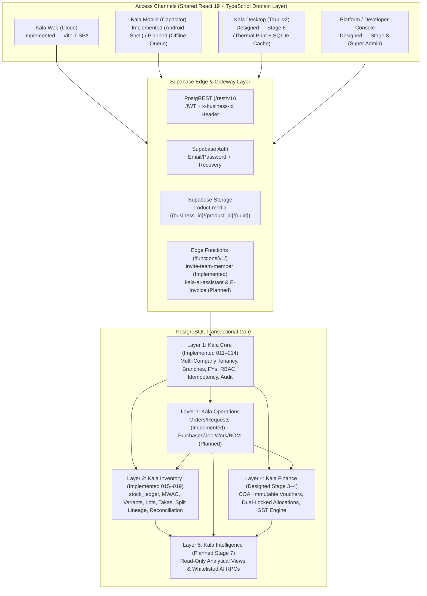

# Kala ERP — System Architecture

> **Document Role:** Authoritative system architecture covering the five-layer ERP design, client channels (Web, Desktop, Mobile), multi-company request lifecycle, transactional RPC model, and offline synchronization boundaries.  
> **Historical Reference:** Previous revisions are preserved in [`archive/ARCHITECTURE_v1.md`](archive/ARCHITECTURE_v1.md) and [`archive/ERP_ARCHITECTURE_Rev3.md`](archive/ERP_ARCHITECTURE_Rev3.md).

---

## 1. High-Level System Topology

Kala uses a **database-enforced transactional architecture** backed by Supabase PostgreSQL. Business invariants (tenant isolation, RBAC, financial year locks, stock valuation, double-entry balancing, and audit logging) live inside PostgreSQL RLS policies, triggers, and `SECURITY DEFINER` RPCs—never solely in frontend code.

---

## 2. Frontend Architecture (`src/`)

### Implemented Structure
- **Framework**: React 19, TypeScript 5.9, Vite 7, Tailwind CSS v4, React Router v7.
- **Commercial Flat ERP UI (Phase 2)**:
  - Design tokens in `src/style.css` and `tailwind.config.ts`: Primary `#1E2A4A`, Canvas `#F4F5F7`, Surface `#FFFFFF`, Border `#E3E5EA`, Text `#1A1D24`, Muted `#667085`, Success `#1F7A4D`, Warning `#B7791F`, Danger `#B42318`, `6px` border radius, zero gradients/shadows/tinted panels.
  - Typography: `IBM Plex Sans` with `Noto Sans Gujarati` and `Noto Sans Devanagari` fallbacks; `tabular-nums` on numeric columns.
  - Formatting (`src/utils/formatters.ts`): `en-IN` currency grouping (`₹12,45,000`) and `DD MMM YYYY` dates.
- **Auth & Multi-Company Context (`src/contexts/AuthContext.tsx`, `src/services/supabase.ts`)**:
  - Loads all `memberships` for the signed-in user and tracks the active `business_id`.
  - Custom `fetch` wrapper in `src/services/supabase.ts` injects `x-business-id` **strictly on `/rest/v1/` and `/functions/v1/`** requests (leaving `/auth/v1/` and `/storage/v1/` untouched).
- **Service Layer (`src/services/`)**:
  - Domain services (`products.ts`, `inventory.ts`, `takaInventory.ts`, `orders.ts`, `orderRequests.ts`, `parties.ts`, `agents.ts`, `adminSettings.ts`, `onboarding.ts`, `team.ts`, `storage.ts`) wrap PostgREST queries and transactional RPCs.
  - All state-changing inventory/order workflows invoke database RPCs; direct client writes to `inventory_stock`, `inventory_lots`, `inventory_takas`, `taka_splits`, `stock_ledger`, and `audit_events` are blocked at the database level.

---

## 3. Public QR Commerce Architecture (Implemented)

Physical textile sample books and showroom tags carry permanent QR codes pointing to:
- `/:slug/p/:designNo` (product gallery, pricing, pcs/set, "Add to order list")
- `/:slug/order-request` (buyer cart submission)
- `/:slug/order/:orderNo` & `/:slug/invoice/:invoiceNo` (order/invoice tracking)

**Fail-Closed Public Gateway**:
- `anon` has **zero** `SELECT`/`INSERT`/`UPDATE`/`DELETE` grants on internal tenant tables.
- Public pages invoke dedicated `SECURITY DEFINER` RPCs (`get_public_product`, `get_public_business_settings`, `submit_order_request`, `create_public_inquiry`, `get_public_order`, `get_public_invoice`) that return sanitized DTOs and enforce hourly per-business/per-phone rate caps via `public_request_log`.

---

## 4. Desktop (Tauri v2) & Offline Synchronization (Designed — Stage 6)

To support high-volume textile counters and unreliable warehouse connectivity without creating separate codebases:
- **Kala Desktop (Tauri v2)**: Wraps the shared React UI in a lightweight Windows native shell (~8–15 MB) with a Rust bridge (`src/platform/bridge.ts`, planned) for:
  - Silent Windows spooler printing, ESC/POS thermal receipts, and TSC/Zebra TSPL/ZPL barcode/taka labels.
  - USB HID barcode scanners.
  - Local SQLite read-through cache for masters and offline draft storage.
- **Hardened Draft-Only Offline Boundary**:
  1. Offline clients may read cached masters and create/edit **Drafts** and **Scan Batches**.
  2. Authoritative confirmations (stock deductions, taka splits, voucher postings, document numbering, FY close) execute **exclusively on the PostgreSQL server**.
  3. Every synced draft carries a deterministic `idempotency_key` + payload hash (`request_hash`) to prevent duplicate submissions on retry.
  4. Optimistic concurrency uses `row_version` (already implemented via `bump_row_version()` trigger on `branches`, `inventory_stock`, `product_variants`, `inventory_lots`, and `inventory_takas`) so stale updates fail with conflict resolution instead of silently overwriting concurrent edits.

---

## 5. Multi-Channel Deployment Model

| Deployment Mode | Target Customer | Architecture | Status |
| :--- | :--- | :--- | :--- |
| **Kala Cloud (SaaS)** | Small & mid-sized textile wholesalers, mills, agents | Shared Supabase PostgreSQL with strict RLS (`business_id = current_business_id()`), module gating via `subscription_plans` | **Implemented** (Multi-tenant core) · **Planned** (Subscription gating, Stage 8) |
| **Kala Enterprise** | Large textile groups requiring dedicated infrastructure | Dedicated/self-hosted Supabase PostgreSQL running the exact same `001`–`0NN` migrations and React/Tauri clients | **Designed** (Stage 8) |
